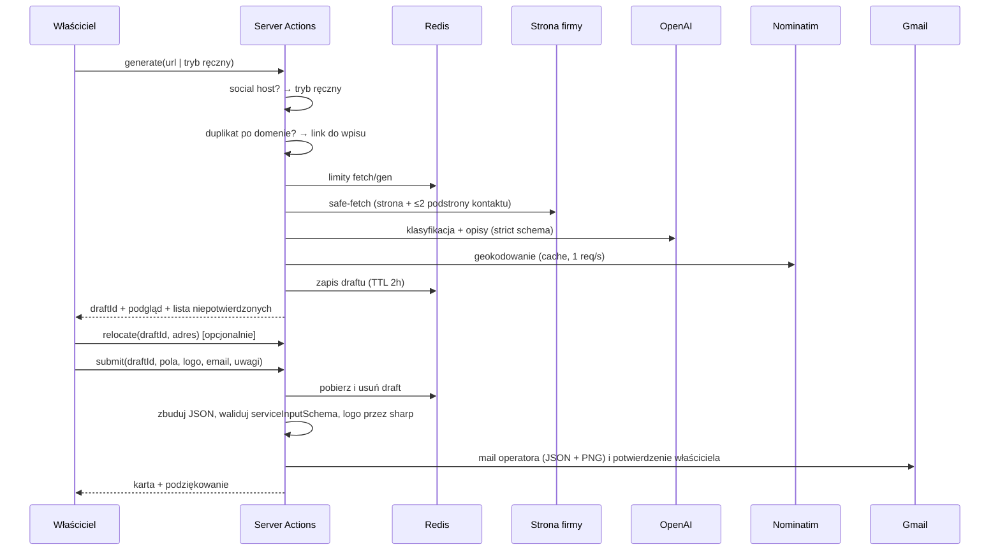

# feat: Dodaj firmę z AI

## Przegląd

Nowa publiczna strona, na którą prowadzi przycisk pod formularzem kontaktowym. Właściciel firmy
wkleja link. Serwer pobiera stronę (z ochroną SSRF), wyciąga fakty z HTML-a i JSON-LD, a LLM
klasyfikuje wpis i pisze opisy pl/uk/en/ru. Właściciel widzi podgląd karty, poprawia pola
faktograficzne, dodaje logo, e-mail i uwagi, po czym wysyła. Operator dostaje mail z plikiem
`data/services/<slug>.json` i logo w załącznikach. Właściciel dostaje potwierdzenie w swoim
języku. **Zero zapisów do bazy.**

## Ujęcie problemu

Zgłoszenia przychodzą dziś jako wolny tekst przez `/kontakt`, a operator robi cały research
ręcznie albo skillem `/dodaj`. Zgłaszają głównie właściciele firm. Feature przenosi pierwszą
połowę `/dodaj` (fakty, klasyfikacja, opisy, współrzędne) na stronę. Akceptacja zostaje ręczna:
seed i `data/services/` są jedynym źródłem prawdy bazy (zob. źródło:
docs/brainstorms/2026-10-10-dodaj-firme-z-ai-requirements.md).

## Śledzenie wymagań

| ID | Wymaganie (skrót) | Unit |
|---|---|---|
| R1 | Przycisk „Dodaj firmę z AI” pod formularzem kontaktowym; formularz zostaje | U10 |
| R2 | Wejście: link; opcjonalne logo; wymagany e-mail | U9 (zob. decyzja D1) |
| R3 | Generowanie pełnego wpisu jak `/dodaj` | U3, U4, U8 |
| R4 | Nie wymyślamy danych; puste pola oznaczone „do uzupełnienia” | U3, U9 |
| R5 | Podgląd wygląda jak prawdziwa karta, w locale UI | U9 |
| R6 | Fallback: nieczytelny link → pusty formularz + opis → generowanie z tekstu | U2, U3, U8, U9 |
| R7 | Duplikat po domenie → informacja z linkiem, zanim ruszy generowanie | U5, U8, U9 |
| R8 | Edycja pól kluczowych; zmiana adresu aktualizuje pin | U4, U8, U9 |
| R9 | Kategoria/zasięg/tagi/opisy nieedytowalne | U5 (draft w Redis), U9 |
| R10 | Pole „Uwagi” | U7, U9 |
| R11 | Propozycja logo ze strony | U2, U6 |
| R12 | Upload logo zastępuje propozycję; typy i limit | U6, U8 |
| R13 | Mail do operatora: podgląd, JSON pod `db:add --dry-run`, logo, uwagi, pola niepotwierdzone/zmienione, reply-to | U6, U7 |
| R14 | Brak zapisu do bazy | wszystkie (granica) |
| R15 | Właściciel widzi kartę i podziękowanie oraz dostaje mail w swoim locale | U7, U9 |
| R16 | 2 generowania na IP na dobę; po limicie komunikat i link do kontaktu | U5, U8, U9 |
| R17 | Fetch tylko publiczne http(s), limit czasu i rozmiaru | U1 |
| R18 | 4 locale; stany ogłaszane czytnikom ekranu | U9, U10 |

Kryteria sukcesu ze źródła:
- JSON przechodzi `db:add --dry-run` bez poprawek struktury → U6, test kontraktu.
- Firma bez www może się zgłosić → R6.
- Zero wymyślonych wartości → U3, weryfikacja faktów.

## Granice scope'u

Przeniesione ze źródła:
- Brak wpisu `pending` w bazie, panelu akceptacji i auth.
- Brak automatycznego maila po publikacji.
- Brak edycji kategorii, zasięgu, tagów i opisów przez właściciela.
- Brak captchy i weryfikacji e-maila.
- Jedna lokalizacja w formularzu; kolejne punkty właściciel wpisuje w uwagach.
- Brak storage na logo.
- Brak edycji istniejących wpisów.

Doprecyzowane w planowaniu:
- Brak SVG jako logo (ryzyko XSS); tylko PNG, JPEG, WebP.
- Brak streamingu postępu; jest tylko etapowany komunikat w trakcie oczekiwania (D6).
- Nie naprawiamy przy okazji `getTodayHours` (wielkość liter w kluczach dni) ani metadata
  strony kontaktu. Oba problemy trafiają do „Ryzyk” jako znane długi.

## Kontekst i research

### Relevantny kod i wzorce

**Schemat wpisu i walidacja**
- `src/db/service-input-schema.ts` — `serviceInputSchema` (strict, superRefine: `local`/`hybrid`
  wymagają lat/lng), `buildServiceSlug`. Importowalny z kodu aplikacji: brak `server-only`, brak
  klienta `db`. To **kontrakt wyjścia** tego feature'a.
- `src/db/add-service.ts` — CLI operatora; nie zmieniamy. `resolveImage` oczekuje pliku w
  `public/services/<image>`.

**LLM**
- `src/lib/semantic-relevance-judge.ts` — wzorzec wywołania OpenAI:
  - wstrzykiwany klient (`JudgeClient`),
  - ręczny `response_format: json_schema, strict: true`, `temperature: 0`,
  - `timeout`, `maxRetries: 0`, przypięty snapshot modelu,
  - typowane `RelevanceJudgeError`, `safeParse` odpowiedzi.
  Test w `semantic-relevance-judge.test.ts` (mock `OpenAI.APIError`).
- `src/lib/category-contexts.ts` — `CATEGORY_CONTEXTS`, czterojęzyczne opisy kategorii.
  Materiał do promptu klasyfikacji.
- `src/lib/categories.ts` — `CATEGORY_VALUES`, jedyne źródło kategorii (z niego `schema.ts`
  buduje `pgEnum`). Enum kategorii w schemacie LLM bierzemy stąd.

**Rate limit i trasy**
- `src/lib/rate-limit.ts` — `checkRateLimit({key,max,windowSeconds})` i `getClientIp(req)`,
  z testem. Użyty w `src/app/api/services/route.ts` (wzorzec testu: `route.test.ts`, mock
  `@/lib/redis`).
- `src/app/api/submit-contact-query/route.ts` — transport nodemailer/Gmail (`env.MY_GMAIL`,
  `replyTo`).

**Server Actions**
- `src/app/[locale]/(dashboard)/dashboard/_actions.ts` — `ActionResult`, `useActionState`,
  `validateImage` (sharp; PNG/JPEG/WebP, 5 MB).
- `_service-schema.ts` (`emptyToNull` + `z.preprocess`) — wzorzec parsowania FormData.

**UI i routing**
- `src/app/[locale]/(main)/_components/service-card/service-card.tsx` — 777 linii, client,
  efekty uboczne: POST licznika popularności, `next/link`, obraz tylko z `/services/`. Wzorzec
  wizualny podglądu.
- `src/app/[locale]/(main)/_components/contact-form.tsx` — formularz kontaktowy; tu ląduje
  przycisk wejścia.
- `src/i18n/routing.ts` — `pathnames` (wpis `'/contact'` → pl `/kontakt`). Nowa strona wymaga
  wpisu.
- `src/lib/map-url-builder.ts` — `buildServiceUrl`, `localePathPrefix()`. Link do istniejącego
  wpisu przy duplikacie.

### Wiedza instytucjonalna

Każda notatka niżej ma powód, dla którego dotyczy tego feature'a.

- `docs/solutions/runtime-errors/2026-08-22-zod-coerce-number-puste-formdata.md`
  - Reguła: każde pole liczbowe/opcjonalne z FormData przechodzi przez `emptyToNull` +
    `z.preprocess`; bez `as string`; bez `?? 0`.
  - Dlaczego: inaczej pin trafi na (0,0).
- `docs/solutions/deployment-issues/2026-08-22-soft-404-notfound-podczas-streamowania.md`
  - Reguła: prefiks locale liczymy funkcją, nigdy `'/en'`.
  - Test: asercja negatywna (ru/uk nie dostają `/en`). Dotyczy linków w mailach i linku do
    duplikatu.
- `docs/solutions/build-errors/2026-08-23-jest-worker-exceptions-rywalizacja-o-next.md`
  - Reguła: gate przy zatrzymanym dev serverze; jeden serwer do weryfikacji ręcznej.
- `docs/solutions/testing-issues/2026-08-22-testy-komponentow-esm-i-resizeobserver.md`
  - Reguła: zależność ESM-only w Jest obsługujemy przez `moduleNameMapper`.
  - Pusty `AggregateError` rozpakowujemy przez `error.errors[0]`.
- Pamięć projektu:
  - Seed jest jedynym źródłem prawdy; `DATABASE_URL` = produkcja. Feature tylko czyta z bazy
    (duplikaty).
  - Upload przez serwer na Vercelu jest efemeryczny, więc logo jedzie tylko w mailu.

### Referencje zewnętrzne

- SSRF:
  - Wzór: lookup w undici `Agent({ connect: { lookup } })` z odrzuceniem adresów
    niepublicznych.
  - Redirecty ręczne z ponowną walidacją; `AbortSignal.timeout`; strumieniowy limit bajtów.
  - `request-filtering-agent` nie działa z natywnym fetch, a `guarded-fetch` to wzorzec, nie
    zależność (decyzja usera).
- OpenAI structured outputs (strict): wszystkie pola wymagane, opcjonalność przez `null`,
  płaski obiekt, enumy OK. Wynik walidujemy ponownie własnym zod.
  https://developers.openai.com/api/docs/guides/structured-outputs
- Vercel Fluid compute:
  - `maxDuration` do 300 s (Hobby), a Server Action dziedziczy segment strony.
  - Body requestu ≤ 4.5 MB.
  - Next: `serverActions.bodySizeLimit` domyślnie 1 MB.
- Nominatim:
  - Polityka: ≤ 1 req/s, identyfikujący User-Agent, obowiązkowy cache, atrybucja OSM.
  - Pojedyncze zgłoszenia mieszczą się w polityce. Zakazany jest autocomplete, więc
    geokodujemy na żądanie, nie per klawisz.
  - https://operations.osmfoundation.org/policies/nominatim/

## Kluczowe decyzje techniczne

**D1. Dwa kroki, logo i e-mail w kroku 2.**
- Krok 1 przyjmuje tylko link (albo przejście do trybu ręcznego).
- Logo, e-mail i uwagi są w kroku 2, razem z edycją.
- Powód: plik nie podróżuje dwa razy, a e-mail nie jest potrzebny do generowania. Pole
  e-mail jest widoczne i wymagane przed wysłaniem, więc intencja R2 zostaje spełniona.

**D2. Draft po stronie serwera, w Redis.**
- Generowanie zapisuje szkic pod losowym `draftId` (TTL 2 h). Klient dostaje `draftId` i
  dane do podglądu.
- Submit wysyła `draftId` + pola edytowalne. Kategoria, zasięg, tagi i opisy pochodzą
  **wyłącznie** z Redis, więc R9 jest egzekwowane serwerowo, a nie tylko w UI.
- Draft jest jednorazowy: atomowe pobranie z usunięciem. Bez tego submit mógłby wysłać
  dowolną treść cudzym mailem bez kosztu generowania.

**D3. Kontrakt wyjścia = `serviceInputSchema`.**
- LLM dostaje osobny, płaski schemat zgodny ze strict mode (pola nullable, enumy z
  `schema.ts`).
- Mapper buduje z niego wejście `serviceInputSchema`. Submit waliduje gotowy JSON tym samym
  schematem, którego używa `db:add`. To jest test kryterium „przechodzi dry-run”.
- Wyjątek świadomy: brak współrzędnych dla `local`/`hybrid` (geokoder nie trafił) nie blokuje
  wysyłki. Mail oznacza go wtedy jako błąd do poprawy, bo właściciel nie ma jak tego naprawić.

**D4. Fakty: JSON-LD > tekst źródła > nic.**
- LLM pisze opisy i klasyfikuje.
- Fakty (telefon, e-mail, adres, godziny) przyjmujemy z JSON-LD `LocalBusiness`, a z LLM tylko
  wtedy, gdy wartość dosłownie (po normalizacji) występuje w pobranym tekście.
- Każde pole puste albo odrzucone trafia na listę „niepotwierdzone” (R4).

**D5. Klasyfikacja w kodzie bez kopii `klasyfikacja.md`.**
- Prompt składa się z `CATEGORY_CONTEXTS` (istniejące źródło w kodzie) i krótkiej stałej
  z regułą zasięgu („czy klient może przyjść i zostać obsłużony?”) oraz regułą języków
  obsługi.
- Ryzyko rozjazdu ze skillem akceptujemy: operator i tak przegląda klasyfikację przy
  `/dodaj`.

**D6. Server Actions + `useActionState`, `maxDuration = 60` na stronie.**
- Generowanie trwa ok. 10–40 s. UI pokazuje etapowany komunikat w regionie `aria-live` i
  blokuje ponowny submit.
- Bez route handlera i bez streamingu NDJSON: konsumentem jest tylko UI tego repo.

**D7. Limity (Redis, `checkRateLimit`, okno 24 h).**

| Klucz | Limit | Uwagi |
|---|---|---|
| `add-business:gen:<ip>` | 2 (R16) | Liczone tuż przed wywołaniem LLM. Nieudany fetch i wykryty duplikat nie zużywają limitu, żeby właściciel z linkiem do Instagrama nie spalił limitu przed trybem ręcznym. Dostępność limitu sprawdzamy przed fetchem, żeby nie pobierać stron na darmo. |
| `add-business:gen:global` | 40 | Bezpiecznik kosztu OpenAI. |
| `add-business:fetch:<ip>` | 6 | Ogranicza użycie serwera jako proxy. |
| `add-business:submit:<ip>` | 2 | |
| relokacja pinu | 10 na draft | Licznik w drafcie. |

**D8. Linki social bez fetchu.**
- Hosty znanych serwisów (instagram, facebook, tiktok, google maps, maps.app.goo.gl,
  t.me itd.) od razu włączają tryb ręczny (R6). Link trafia do `socials`/`webpage` szkicu.
- Nie wykluczamy ich z detekcji duplikatów po domenie (R7): duplikaty sprawdzamy tylko dla
  domen własnych.

**D9. Logo: sharp, bez nowej zależności.**
- Upload:
  - limit 2 MB, `serverActions.bodySizeLimit: '3mb'`;
  - format rozpoznaje sharp z treści pliku, a nie `file.type`; PNG/JPEG/WebP;
  - re-enkodowanie do PNG ≤ 512 px.
- Propozycja ze strony:
  - kandydaci w kolejności og:image → apple-touch-icon → icon;
  - podgląd ładuje URL kandydata bezpośrednio w ``;
  - przy submit serwer pobiera go przez safe-fetch i przepuszcza przez ten sam pipeline sharp;
  - porażka nie blokuje wysyłki, mail oznacza „brak logo”.

**D10. Pin w podglądzie: statyczny obrazek mapy.**
- Statyczny obraz Mapbox z istniejącym publicznym tokenem `pk.` (ten sam, co w
  `overview-map.tsx`) plus atrybucja OSM/Mapbox.
- Zmiana adresu → przycisk „Sprawdź na mapie” → akcja `relocate` (geokodowanie z cache).
  Bez mapbox-gl w tym flow.

**D11. Maile tekstowe przez wspólny moduł nodemailer.**
- Transport Gmail wyciągamy do `src/lib/mailer.ts`; trasa kontaktu przechodzi na niego.
- Oba maile są **plain text**: brak wstrzykiwania HTML z treści strony lub uwag. Z tematu
  usuwamy znaki nowej linii.
- Operator dostaje `replyTo` = e-mail właściciela.
- Potwierdzenie dla właściciela idzie w jego locale (`getTranslations({ locale })`).

**D12. Podgląd jako osobny komponent, odwzorowany z `service-card`.**
- `ServiceCard` ma efekty uboczne (licznik popularności, callbacki mapy, obraz tylko z
  `/services/`) i 777 linii.
- Zamiast dokładać mu tryb „preview”, budujemy `business-card-preview`. Odwzorowuje klasy
  karty 1:1 (reguła „duplikacja > złożoność”, pamięć: mierz `left` logo, `Card` ma własny
  padding).

**D13. Ścieżka strony.**
- `pathnames['/add-business']`: pl `/dodaj-firme`, en/ru/uk `/add-business`.
- Strona indeksowalna (fraza „dodaj firmę” ma wartość SEO).
- canonical i alternates budowane helperami locale, nie ręcznie.

**D14. Model.**
- Przypięty snapshot `gpt-4.1-mini` jako stała w module: bez tokenów reasoningu, przewidywalny
  czas, ok. $0.01 za generowanie.
- `max_completion_tokens` ok. 3000, `temperature: 0`.

## Otwarte pytania

### Rozwiązane podczas planowania

Pytania odroczone ze źródła:

| Pytanie | Rozwiązanie |
|---|---|
| Osobna strona czy sekcja kontaktu? | Osobna strona (D13), przycisk na `/kontakt` (U10). |
| Model, koszt, czas? | D14, D6. Limit kosztu dobowo przez D7 `gen:global`. |
| Geokodowanie na produkcji? | Nominatim z cache Redis i blokadą 1 req/s (U4). Pomijamy go, gdy JSON-LD ma `geo`. |
| Współdzielenie reguł klasyfikacji? | D5. |
| Normalizacja domeny? | Host lowercase bez `www.`, porównanie dokładne. Hosty social wykluczone (D8). |
| Heurystyka logo? | D9. |
| Transport maila? | Gmail/nodemailer (decyzja usera), D11. |
| SSRF? | Własny guard (decyzja usera), U1. |

Nowe pytania z planowania:

| Pytanie | Rozwiązanie |
|---|---|
| Nowe zależności | Tylko `cheerio`, w dokładnej wersji, wyłącznie na serwerze (decyzja usera). Guard SSRF bez biblioteki. Klasyfikacja IP: `node:net` + własne zakresy (bez `ipaddr.js`, chyba że jest już bezpośrednią zależnością; sprawdzi U1). |
| Tryb ręczny | Pola kluczowe + miasto + opis działalności (wymagany, 50–1000 znaków). LLM klasyfikuje i pisze opisy wyłącznie z tego tekstu. Fakty pochodzą od właściciela, więc nie są „niepotwierdzone”. |

### Odroczone do implementacji

- Dokładny prompt systemowy i schemat LLM — kształtuje się na fixture'ach HTML.
- Normalizacja telefonu przy dosłownym porównaniu ze źródłem (spacje, `+48`, myślniki).
- Lista hostów social: startowa w D8, doprecyzowana przy implementacji.
- Czy `ipaddr.js` jest bezpośrednią zależnością (`package.json`), czy tylko przechodnią.
  Przechodniej nie używamy.
- Brak `docs/DESIGN.md`: buildery UI bazują na nextjs-stack-guidelines i `service-card`.
  Utwórz go przed kolejnym feature'em UI.

## Przepływ

## Implementation Units

### Faza A — moduły serwerowe (`src/lib/add-business/`)

- [x] **Unit 1: Bezpieczne pobieranie strony (guard SSRF)**

**Cel:** Pobrać HTML z linku podanego przez użytkownika tak, żeby nie dało się dotrzeć do
zasobów wewnętrznych ani zawiesić funkcji.

**Wymagania:** R17, R3, R11

**Zależności:** brak

**Pliki:**
- Stwórz: `src/lib/add-business/safe-fetch.ts`
- Test (unit): `src/lib/add-business/safe-fetch.test.ts`

**Delegate to:** feature-builder-web-data

**Skills in play:** nextjs-stack-guidelines, security

**Podejście:**
- Walidacja URL:
  - tylko `http:` i `https:`, porty domyślne;
  - odrzucamy userinfo w URL;
  - literal IP w hoście sprawdzamy jak wynik DNS.
- Połączenie: undici `Agent` z własnym `connect.lookup`. Każdy rozwiązany adres musi być
  publicznym unicastem; odrzucamy loopback, prywatne, link-local (w tym 169.254.169.254),
  CGNAT, multicast, IPv6 ULA i link-local oraz IPv4-mapped IPv6. Walidacja w chwili połączenia
  zamyka DNS rebinding.
- Redirecty: `redirect: 'manual'`, ≤ 3 skoki, każdy `Location` walidowany od nowa.
- Limity: `AbortSignal.timeout` ok. 8 s na żądanie; strumieniowy limit ok. 2 MB z przerwaniem.
- Typ odpowiedzi: `content-type` musi być `text/html` albo `application/xhtml+xml`. Wariant
  dla obrazków (logo, U6) akceptuje `image/*` z osobnym limitem.
- Wynik to discriminated union `{ ok: true, finalUrl, body } | { ok: false, code }`.
  - Kody: `INVALID_URL`, `BLOCKED_ADDRESS`, `TIMEOUT`, `TOO_LARGE`, `BAD_CONTENT_TYPE`,
    `HTTP_ERROR`, `TOO_MANY_REDIRECTS`.
  - Szczegóły tylko w logu serwera, nigdy do klienta.
- Funkcja klasyfikacji IP jest eksportowana i testowana osobno.

**Wzorce do naśladowania:** typowane błędy jak `RelevanceJudgeError` w
`src/lib/semantic-relevance-judge.ts`.

**Scenariusze testowe:**
- [Unit] Klasyfikator IP odrzuca: `127.0.0.1`, `10.0.0.5`, `172.16.0.1`, `192.168.1.1`,
  `169.254.169.254`, `100.64.0.1`, `0.0.0.0`, `::1`, `fc00::1`, `fe80::1`,
  `::ffff:127.0.0.1`. Przepuszcza publiczny IPv4 i IPv6.
- [Unit] URL z `file:`, `ftp:`, `javascript:`, z userinfo, z portem 22 → `INVALID_URL`.
- [Unit] Redirect na adres prywatny → `BLOCKED_ADDRESS`. Cztery redirecty →
  `TOO_MANY_REDIRECTS`. Transport mockowany, bez sieci.
- [Unit] Odpowiedź większa niż limit → `TOO_LARGE`. `application/pdf` → `BAD_CONTENT_TYPE`.
  Brak odpowiedzi w czasie → `TIMEOUT`.
- [Unit] Happy path: 200 `text/html` → `ok: true` z `finalUrl` po redirectcie.

**Weryfikacja:**
- `npx jest src/lib/add-business/safe-fetch.test.ts` przechodzi.
- `npx tsc --noEmit` bez błędów.

---

- [x] **Unit 2: Ekstrakcja z HTML (tekst, JSON-LD, logo, link kontaktu, hosty social)**

**Cel:** Zamienić HTML na materiał dla LLM i na fakty strukturalne.

**Wymagania:** R3, R4, R6, R11

**Zależności:** brak. Dodaje zależność `cheerio` w dokładnej wersji (zgoda usera).

**Pliki:**
- Modyfikuj: `package.json`, `package-lock.json` (cheerio, exact version)
- Stwórz: `src/lib/add-business/html-extract.ts`
- Stwórz: `src/lib/add-business/link-kind.ts` (klasyfikacja linku: social / własna domena;
  normalizacja hosta)
- Test (unit): `src/lib/add-business/html-extract.test.ts`
- Test (unit): `src/lib/add-business/link-kind.test.ts`
- Stwórz (fixtures):
  - `tests/fixtures/add-business/local-business-jsonld.html`
  - `tests/fixtures/add-business/no-jsonld.html`
  - `tests/fixtures/add-business/graph-jsonld.html`

**Delegate to:** feature-builder-web-data

**Skills in play:** nextjs-stack-guidelines, security

**Podejście:**
- Tekst:
  - usuwamy `script, style, noscript, svg, iframe`;
  - zostawiamy treść `body` z zachowaniem stopki;
  - zwijamy białe znaki i przycinamy do ok. 12 tys. znaków.
- JSON-LD:
  - każdy `script[type=application/ld+json]` parsujemy w `try/catch` z logiem (nie pusty
    catch);
  - spłaszczamy `@graph` i tablice;
  - bierzemy węzły `LocalBusiness`/podtypy/`Organization`;
  - wyciągamy: `name`, `address`, `telephone`, `email`, `geo`, `openingHoursSpecification`,
    `sameAs`;
  - walidujemy zod `safeParse`, a niepoprawne pole pomijamy.
- Mapowanie godzin: `openingHoursSpecification` → klucze `monday`…`sunday` (lowercase, zgodnie
  z `serviceInputSchema`) z `HH:MM`.
- Kandydaci logo w kolejności og:image → apple-touch-icon → icon. Absolutny URL liczymy
  względem `finalUrl`.
- Link kontaktu:
  - ten sam origin, tekst albo href pasuje do `kontakt|contact|контакт`;
  - fallback `/kontakt`, `/contact`;
  - najwyżej 2 podstrony.
- `link-kind`:
  - normalizacja hosta: lowercase, bez `www.`;
  - wykrycie hostów social z D8.
  Używane przez U5 (duplikaty) i U8 (tryb ręczny).

**Wzorce do naśladowania:** czyste funkcje, fixture'y w `tests/fixtures/` (reguła repo).

**Scenariusze testowe:**
- [Unit] Fixture z `LocalBusiness` → poprawne adres, telefon, godziny (lowercase dni), geo.
- [Unit] Fixture z `@graph` i zepsutym blokiem JSON-LD → poprawny węzeł wyciągnięty, zepsuty
  zalogowany, brak wyjątku.
- [Unit] Fixture bez JSON-LD → puste fakty strukturalne, niepusty tekst, skrypty usunięte.
- [Unit] Logo: względny `apple-touch-icon` → absolutny URL; brak og:image → następny kandydat.
- [Unit] `link-kind`:
  - `https://www.instagram.com/x` → social;
  - `https://maps.app.goo.gl/…` → social;
  - `https://WWW.Firma.pl/o-nas` → własna domena `firma.pl`.

**Weryfikacja:**
- `npx jest src/lib/add-business/html-extract.test.ts src/lib/add-business/link-kind.test.ts`
  przechodzi.
- `npx tsc --noEmit` bez błędów.

---

- [x] **Unit 3: Szkic z LLM + weryfikacja faktów**

**Cel:** Z materiału strony (albo z tekstu właściciela) zbudować szkic wpisu: klasyfikacja,
tagi, opisy w 4 językach oraz fakty, które przeszły weryfikację, z listą pól
niepotwierdzonych.

**Wymagania:** R3, R4, R6, R9

**Zależności:** Unit 2 (typy faktów strukturalnych)

**Pliki:**
- Stwórz: `src/lib/add-business/draft-schema.ts` (schemat strict dla LLM, typ `BusinessDraft`)
- Stwórz: `src/lib/add-business/llm-draft.ts` (prompt + wywołanie, wstrzykiwany klient)
- Stwórz: `src/lib/add-business/verify-facts.ts` (scalenie JSON-LD > LLM-zweryfikowane > null,
  lista `unconfirmed`)
- Test (unit): `src/lib/add-business/llm-draft.test.ts`
- Test (unit): `src/lib/add-business/verify-facts.test.ts`

**Delegate to:** feature-builder-web-data

**Skills in play:** nextjs-stack-guidelines, security

**Podejście:**
- Schemat LLM:
  - płaski, wszystkie pola wymagane, opcjonalność przez `null`;
  - `category` jako enum z `CATEGORY_VALUES` (`src/lib/categories.ts`, jedyne źródło
    kategorii), `coverage` z enuma w `src/db/schema.ts`;
  - `languages` jako lista kodów;
  - `tags`: 3–5 obiektów `{pl,uk,en,ru}`;
  - `descriptions`: `{pl,uk,en,ru}`;
  - fakty kandydujące: name, street, postcode, city, phone, email, openingHours.
- Prompt:
  - treść źródła w wyraźnych ogranicznikach jako **dane niezaufane** (ochrona przed
    prompt injection);
  - reguły „brak w źródle = null, nie zgaduj”;
  - kontekst kategorii z `CATEGORY_CONTEXTS`, reguła zasięgu i języków obsługi (D5);
  - zasady opisów z `/dodaj` faza 4: 300–600 znaków, lokalizacja zamiast kalki, zero waty i
    cen.
- Dwa wejścia: `fromPage({ text, structured, url })` i
  `fromOwner({ fields, description, link })`. W trybie właściciela fakty pochodzą od niego,
  a LLM tylko klasyfikuje i pisze opisy.
- Wywołanie: wzorzec z `semantic-relevance-judge.ts` (D14). Odpowiedź przechodzi przez zod
  `safeParse`. `refusal` / zła odpowiedź / błąd API → typowany `DraftGenerationError`
  (`UPSTREAM_FAILED`, `INVALID_RESPONSE`).
- `verify-facts`:
  - fakt z JSON-LD wygrywa;
  - fakt z LLM przyjmujemy tylko wtedy, gdy znormalizowany występuje w tekście źródła
    (telefon: same cyfry; e-mail: lowercase);
  - wszystko inne → `null` + nazwa pola w `unconfirmed`.

**Notatka wykonawcza:** `verify-facts` implementuj test-first. To jedyna bariera przed
wymyślonymi danymi (kryterium sukcesu „zero wymyślonych wartości”).

**Wzorce do naśladowania:** `src/lib/semantic-relevance-judge.ts` i jego test (wstrzykiwany
klient, `OpenAI.APIError`).

**Scenariusze testowe:**
- [Unit] LLM zwraca telefon, którego nie ma w tekście źródła → telefon `null`, `phone` w
  `unconfirmed`.
- [Unit] JSON-LD ma telefon A, LLM zwraca B → wynik A.
- [Unit] Telefon w źródle `+48 22 123-45-67`, LLM zwraca `221234567` → przyjęty po
  normalizacji.
- [Unit] Mock klienta rzuca `APIError` → `DraftGenerationError('UPSTREAM_FAILED')`.
  Odpowiedź niezgodna ze schematem → `INVALID_RESPONSE`.
- [Unit] `fromOwner`: fakty właściciela przechodzą bez zmian i bez wpisów w `unconfirmed`.
  Prompt zawiera opis właściciela (asercja na argumencie przekazanym do mocka).
- [Unit] Kategoria spoza enumu w odpowiedzi → `INVALID_RESPONSE`, a nie ciche `others`.

**Weryfikacja:**
- `npx jest src/lib/add-business/llm-draft.test.ts src/lib/add-business/verify-facts.test.ts`
  przechodzi.
- `npx tsc --noEmit` bez błędów.

---

- [x] **Unit 4: Geokodowanie (Nominatim z cache i throttlingiem)**

**Cel:** Wyliczyć współrzędne dla `local`/`hybrid` zgodnie z polityką Nominatim i kontrolami z
`/dodaj` faza 2.

**Wymagania:** R3, R8

**Zależności:** brak

**Pliki:**
- Stwórz: `src/lib/add-business/geocode.ts`
- Test (unit): `src/lib/add-business/geocode.test.ts`

**Delegate to:** feature-builder-web-data

**Skills in play:** nextjs-stack-guidelines, security

**Podejście:**
- Zapytanie: `countrycodes=pl`, `format=jsonv2`, `limit=1`, `addressdetails=1`. User-Agent
  identyfikujący serwis z `env.NEXT_PUBLIC_SITE_URL`. Żadnego `process.env`.
- Cache: Redis po znormalizowanym adresie, TTL 30 dni, cache'ujemy również „nie znaleziono”.
- Throttling: globalna blokada 1 req/s przez Redis `SET NX PX 1000`. Gdy blokada jest zajęta,
  jedno krótkie ponowienie, potem wynik `RATE_LIMITED`.
- Kontrole jak w `/dodaj` faza 2: `display_name` zawiera miasto; lat 49–55, lng 14–24;
  wynik bez numeru budynku oznaczamy `approximate: true`.
- Pomijamy wywołanie, gdy JSON-LD ma `geo` w zakresie Polski.
- Wynik: `{ ok: true, lat, lng, postcode?, voivodeship?, approximate } | { ok: false, code }`.
  Województwo mapujemy na enum `voivodeship`; brak dopasowania → `null`.

**Wzorce do naśladowania:** mock `@/lib/redis` jak w `src/app/api/services/route.test.ts`.

**Scenariusze testowe:**
- [Unit] Trafienie w cache → brak wywołania `fetch`.
- [Unit] Wynik spoza Polski albo z innym miastem w `display_name` → `ok: false`
  (`MISMATCH`).
- [Unit] Wynik bez `house_number` → `approximate: true`.
- [Unit] Zajęta blokada przy obu próbach → `RATE_LIMITED` bez wywołania sieci.
- [Unit] `state: "województwo mazowieckie"` → `voivodeship: 'mazowieckie'`.

**Weryfikacja:**
- `npx jest src/lib/add-business/geocode.test.ts` przechodzi.
- `npx tsc --noEmit` bez błędów.

---

- [x] **Unit 5: Draft w Redis, limity i wykrywanie duplikatów**

**Cel:** Przechować szkic serwerowo (D2), wyegzekwować limity (D7) i znaleźć istniejący wpis
po domenie (R7).

**Wymagania:** R7, R9, R16

**Zależności:** Unit 2 (`link-kind`), Unit 3 (typ `BusinessDraft`)

**Pliki:**
- Stwórz: `src/lib/add-business/draft-store.ts` (save / get / consume, TTL 2 h, licznik
  relokacji)
- Stwórz: `src/lib/add-business/limits.ts` (stałe D7 + funkcje `peek`/`consume` na bazie
  `checkRateLimit`)
- Modyfikuj: `src/lib/queries.ts` (dodaj `findServiceByDomain(host, locale)` zwracające dane
  potrzebne do `buildServiceUrl`)
- Test (unit): `src/lib/add-business/draft-store.test.ts`
- Test (unit): `src/lib/add-business/limits.test.ts`

**Delegate to:** feature-builder-web-data

**Skills in play:** nextjs-stack-guidelines, security

**Podejście:**
- `draftId` to `crypto.randomUUID()`. Wartość w Redis jest serializowanym `BusinessDraft` +
  metadane: locale, źródło (`page`/`owner`), kandydat logo, licznik relokacji.
- Odczyt walidujemy zod, bo dane z Redis to granica systemu.
- `consume` atomowo pobiera i usuwa szkic (GETDEL). Drugi submit z tym samym `draftId`
  dostaje `DRAFT_EXPIRED`.
- `limits`: `peek` (odczyt bez inkrementacji) przed fetchem, `consume` tuż przed LLM, osobno
  dla klucza IP i globalnego.
- `findServiceByDomain`:
  - zawężenie w SQL po `serviceLocationsTable.webpage` (ilike na hoście);
  - dokładne porównanie znormalizowanego hosta w JS;
  - bez wczytywania całej tabeli;
  - zwraca tylko aktywne wpisy.

**Wzorce do naśladowania:** `src/lib/rate-limit.ts` i jego test; `src/lib/queries.ts`
(`server-only`, wybór konkretnych kolumn).

**Scenariusze testowe:**
- [Unit] `save` → `consume` zwraca draft. Drugi `consume` → `DRAFT_EXPIRED`.
- [Unit] Uszkodzony JSON w Redis → `DRAFT_EXPIRED` (zalogowane), a nie wyjątek.
- [Unit] Trzecie `consume` limitu `gen:<ip>` w oknie → `allowed: false` z `retryAfter`.
  `peek` nie inkrementuje.
- [Unit] Wyczerpany limit globalny blokuje mimo wolnego limitu IP.

**Weryfikacja:**
- `npx jest src/lib/add-business/draft-store.test.ts src/lib/add-business/limits.test.ts`
  przechodzi.
- `npx tsc --noEmit` bez błędów.

**Operator checklist:**
- [ ] Ręcznie sprawdź `findServiceByDomain` dla domeny istniejącego wpisu. Baza dev =
  produkcja, tylko odczyt.

---

- [x] **Unit 6: Złożenie wpisu JSON i obróbka logo**

**Cel:** Z draftu i edycji właściciela zbudować dokładnie to, co operator zapisze jako
`data/services/<slug>.json`, oraz przygotować PNG logo.

**Wymagania:** R12, R13, R11; kryterium „JSON przechodzi `db:add --dry-run`”

**Zależności:** Unit 1, Unit 3, Unit 5

**Pliki:**
- Stwórz: `src/lib/add-business/build-service-json.ts`
- Stwórz: `src/lib/add-business/owner-edits-schema.ts` (zod dla pól edytowalnych z FormData:
  `emptyToNull` + `z.preprocess`; e-mail zgłaszającego; uwagi ≤ 2000 znaków)
- Stwórz: `src/lib/add-business/logo.ts`
- Test (unit): `src/lib/add-business/build-service-json.test.ts`
- Test (unit): `src/lib/add-business/owner-edits-schema.test.ts`
- Test (unit): `src/lib/add-business/logo.test.ts`
- Stwórz (fixtures): `tests/fixtures/add-business/logo.png`, `tests/fixtures/add-business/fake-png.svg`

**Delegate to:** feature-builder-web-data

**Skills in play:** nextjs-stack-guidelines, security

**Podejście:**
- `build-service-json`:
  - scala draft z edycjami; edycja wygrywa;
  - liczy `changedByOwner` (lista pól różnych od draftu);
  - ustawia `image: "<slug>.png"` tylko gdy jest logo;
  - pomija klucze nieznane schematowi (schemat jest `strict`).
- Walidacja wyniku `serviceInputSchema.safeParse`. Brak lat/lng przy `local`/`hybrid` to
  akceptowany przypadek z D3, zgłaszany jako `missingCoordinates`. Każdy inny błąd jest bugiem
  i zwraca `INVALID_ENTRY` z logiem.
- Wynik: `{ json, slug, unconfirmed, changedByOwner, missingCoordinates }`.
- `owner-edits-schema`:
  - `openingHours` jako 7 par pól `open`/`close`, pusta para = dzień zamknięty;
  - `languages` jako lista z dozwolonego zbioru kodów;
  - `webpage` musi być URL-em http(s).
- `logo`:
  - upload: limit 2 MB, sharp `metadata()` → tylko png/jpeg/webp, inaczej `INVALID_LOGO`;
    resize ≤ 512 px, re-enkodowanie do PNG;
  - kandydat ze strony: safe-fetch (wariant obrazkowy z U1), potem ten sam pipeline;
    porażka → `null` + flaga w mailu, bez blokowania.

**Notatka wykonawcza:** zacznij od testu kontraktu: kompletny draft + edycje → wynik przechodzi
`serviceInputSchema`. To zakotwiczenie kryterium sukcesu.

**Wzorce do naśladowania:**
- `src/app/[locale]/(dashboard)/dashboard/_service-schema.ts` (`emptyToNull`) i jego test;
- `validateImage` w dashboardowym `_actions.ts`, bez zapisu na dysk.

**Scenariusze testowe:**
- [Unit] Pełny draft `hybrid` z koordynatami + edycje → `serviceInputSchema.safeParse`
  sukces; `image` = `<slug>.png`.
- [Unit] Draft `local` bez współrzędnych → wynik zbudowany, `missingCoordinates: true`, brak
  wyjątku.
- [Unit] Edycja telefonu → `changedByOwner` zawiera `phoneNumber`. Pole niezmienione → nie
  zawiera.
- [Unit] FormData z każdym polem ustawionym na `''` (nie pominiętym) → pola `null`, nie `0`.
  Puste godziny → dzień pominięty.
- [Unit] Uszkodzony e-mail zgłaszającego → błąd pola z kluczem do tłumaczenia.
- [Unit] Logo: poprawny PNG → bufor PNG ≤ 512 px. SVG z rozszerzeniem `.png` →
  `INVALID_LOGO`. Plik 3 MB → `LOGO_TOO_LARGE`.

**Weryfikacja:**
- `npx jest src/lib/add-business/build-service-json.test.ts src/lib/add-business/owner-edits-schema.test.ts src/lib/add-business/logo.test.ts`
  przechodzi.
- `npx tsc --noEmit` bez błędów.

---

- [x] **Unit 7: Maile — wspólny transport, mail operatora, potwierdzenie właściciela**

**Cel:** Wysłać oba maile z R13 i R15 przez istniejący kanał Gmail.

**Wymagania:** R10, R13, R15

**Zależności:** Unit 6

**Pliki:**
- Stwórz: `src/lib/mailer.ts` (transport nodemailer z `env`, funkcja `sendMail` z typowanym
  błędem)
- Modyfikuj: `src/app/api/submit-contact-query/route.ts` (użycie `mailer.ts`; przy okazji
  przestaje zwracać `String(error)` do klienta)
- Stwórz: `src/lib/add-business/submission-emails.ts` (budowa treści obu maili)
- Test (unit): `src/lib/add-business/submission-emails.test.ts`
- Test (unit): `src/lib/mailer.test.ts`

**Delegate to:** feature-builder-web-data

**Skills in play:** nextjs-stack-guidelines, security

**Podejście:**
- Mail operatora:
  - plain text, temat `[Polvia] Zgłoszenie: <nazwa>` (bez znaków nowej linii);
  - sekcje: dane karty, kategoria/zasięg/tagi, „Niepotwierdzone”, „Zmienione przez
    właściciela”, „Brak współrzędnych”, „Brak logo”, uwagi, link źródłowy, tryb (strona /
    ręczny);
  - gotowa komenda dry-run do skopiowania;
  - załączniki: `<slug>.json` (sformatowany) i `<slug>.png`;
  - `replyTo` = e-mail właściciela.
- Potwierdzenie właściciela:
  - plain text w locale zgłoszenia (`getTranslations({ locale, namespace })`);
  - kopia danych faktograficznych, bez opisów w 4 językach (krótko);
  - informacja, że publikacja nastąpi po weryfikacji.
- Błąd wysyłki maila operatora = błąd submitu (`SEND_FAILED`). Draft jest już skonsumowany,
  więc w logu ląduje cały JSON, żeby zgłoszenie nie przepadło (R14: nic w bazie).
- Błąd potwierdzenia nie cofa sukcesu; tylko log.

**Wzorce do naśladowania:** `src/app/api/submit-contact-query/route.ts` (transport, `replyTo`).

**Scenariusze testowe:**
- [Unit] Mail operatora zawiera sekcję „Niepotwierdzone” z nazwami pól, uwagi i dwa
  załączniki o nazwach `<slug>.json` / `<slug>.png`; JSON w załączniku parsuje się.
- [Unit] Nazwa firmy z `\r\n` → temat bez znaków nowej linii.
- [Unit] Potwierdzenie dla `uk` zawiera tekst z `messages/uk.json`, nie polski.
- [Unit] Transport rzuca błąd → `sendMail` zwraca typowany błąd, bez surowego komunikatu na
  zewnątrz.
- [Unit] Istniejący test/zachowanie trasy kontaktu nadal działa po przejściu na `mailer.ts`.

**Weryfikacja:**
- `npx jest src/lib/add-business/submission-emails.test.ts src/lib/mailer.test.ts` przechodzi.
- `npx tsc --noEmit` bez błędów.

### Faza B — akcje, strona, wejście

- [ ] **Unit 8: Orkiestracja i Server Actions**

**Cel:** Połączyć moduły w trzy akcje: `generateDraft`, `relocate` i `submitDraft`. Każda ma
kontrakt wyniku dla UI.

**Wymagania:** R3, R6, R7, R8, R12, R14, R16

**Zależności:** Unity 1–7

**Pliki:**
- Stwórz: `src/lib/add-business/generate-draft.ts` (orkiestrator z wstrzykiwanymi zależnościami)
- Stwórz: `src/lib/add-business/submit-draft.ts` (orkiestrator)
- Stwórz: `src/lib/add-business/types.ts` (discriminated unions wyników akcji, eksportowane do
  UI)
- Stwórz: `src/app/[locale]/(header)/add-business/_actions.ts` (`'use server'`, cienkie: IP z
  `headers()`, locale, parsowanie FormData, wywołanie orkiestratora)
- Modyfikuj: `next.config.ts` (`experimental.serverActions.bodySizeLimit: '3mb'`)
- Test (unit): `src/lib/add-business/generate-draft.test.ts`
- Test (unit): `src/lib/add-business/submit-draft.test.ts`

**Delegate to:** feature-builder-web-data

**Skills in play:** nextjs-stack-guidelines, security

**Podejście:**
- Kontrakt `generateDraft` (unia po `status`):
  - `ready` (draftId, podgląd, unconfirmed, logoCandidate, pin);
  - `duplicate` (nazwa + URL wpisu z `buildServiceUrl`, locale-aware);
  - `needsManual` (powód: `SOCIAL_LINK` | `UNREADABLE`, link prefill);
  - `limited` (retryAfter);
  - `error` (code).
- Kolejność w `generateDraft` (tryb link):
  1. walidacja URL;
  2. social → `needsManual`;
  3. duplikat → `duplicate`;
  4. `peek` limitu gen;
  5. limit fetch;
  6. safe-fetch strony + ≤ 2 podstron (`Promise.allSettled`);
  7. porażka → `needsManual('UNREADABLE')`;
  8. `consume` gen (IP + global);
  9. LLM → verify;
  10. geokodowanie (gdy local/hybrid i brak geo);
  11. `save` draftu.
- Tryb ręczny: walidacja pól właściciela + opisu → `consume` gen → LLM `fromOwner` →
  geokodowanie → `save`.
- `relocate(draftId, adres)`: limit 10 na draft, geokodowanie, aktualizacja draftu, zwrot
  pinu albo kodu.
- `submitDraft`:
  1. walidacja edycji;
  2. limit submit;
  3. `consume` draftu;
  4. jeśli adres różni się od geokodowanego → geokodowanie;
  5. `build-service-json`;
  6. logo;
  7. maile;
  8. wynik `sent` z danymi karty do ekranu podziękowania.
- Odpowiedź do klienta zawiera tylko kody błędów (`{ error: { code, message } }`), nigdy
  surowe błędy.
- Brak `revalidatePath`: nic się w bazie nie zmienia. Odstępstwo od wzorca mutacji jest
  świadome.
- `maxDuration` ustawia strona (U9); akcja dziedziczy konfigurację segmentu.

**Notatka wykonawcza:** orkiestratory testuj z wstrzykniętymi fałszywymi zależnościami (fetch,
LLM, geocode, store, mailer). Mockujemy tylko usługi zewnętrzne, nie testowaną logikę.

**Wzorce do naśladowania:**
- wstrzykiwanie zależności z `semantic-relevance-judge.ts`;
- `ActionResult` + `useActionState` z dashboardu (ale wynik jako discriminated union, nie
  `success: boolean`).

**Scenariusze testowe:**
- [Unit] Link Instagram → `needsManual('SOCIAL_LINK')`. Zero wywołań fetch, LLM i limitu gen.
- [Unit] Domena istniejącego wpisu → `duplicate` z URL. Dla locale `ru` URL nie zaczyna się
  od `/en` (asercja negatywna z learned-patterns).
- [Unit] Fetch kończy się `TIMEOUT` → `needsManual('UNREADABLE')`, limit gen nie zużyty.
- [Unit] Wyczerpany limit gen → `limited` przed jakimkolwiek fetchem.
- [Unit] Happy path → `ready` i draft zapisany. LLM wywołany raz, limit gen zużyty raz.
- [Unit] `submitDraft` z wygasłym draftem → `error('DRAFT_EXPIRED')`, bez maila.
- [Unit] `submitDraft` z FormData zawierającą sfałszowaną `category` → kategoria w JSON
  pochodzi z draftu (R9 serwerowo).
- [Unit] Mail operatora pada → `error('SEND_FAILED')` i log z JSON-em. Potwierdzenie pada →
  `sent` mimo to.

**Weryfikacja:**
- `npx jest src/lib/add-business/generate-draft.test.ts src/lib/add-business/submit-draft.test.ts`
  przechodzi.
- `npx tsc --noEmit` bez błędów.
- grep: `_actions.ts` nie zawiera `process.env` ani `console.log`.

---

- [ ] **Unit 9: Strona flow i komponenty UI**

**Cel:** Strona z trzema stanami: link → podgląd + edycja → podziękowanie, plus tryb ręczny,
duplikat i limit.

**Wymagania:** R2, R4, R5, R6, R7, R8, R9, R10, R12, R15, R16, R18

**Zależności:** Unit 8 (kontrakty z `types.ts`)

**Pliki:**
- Stwórz: `src/app/[locale]/(header)/add-business/page.tsx` (Server Component; metadata;
  `export const maxDuration = 60`)
- Stwórz: `src/app/[locale]/(header)/add-business/_components/add-business-flow/add-business-flow.tsx`
  (client; maszyna stanów jako discriminated union)
- Stwórz: `.../_components/link-step/link-step.tsx` + `link-step.test.tsx`
- Stwórz: `.../_components/manual-step/manual-step.tsx` + `manual-step.test.tsx`
- Stwórz: `.../_components/draft-editor/draft-editor.tsx` + `draft-editor.test.tsx` (pola
  edytowalne, logo, e-mail, uwagi, „Sprawdź na mapie”)
- Stwórz: `.../_components/business-card-preview/business-card-preview.tsx` +
  `business-card-preview.test.tsx` + `business-card-preview.stories.tsx`
- Stwórz: `.../_components/submitted-state/submitted-state.tsx` + `submitted-state.test.tsx`
- Modyfikuj: `src/i18n/routing.ts` (`'/add-business'`: pl `/dodaj-firme`, reszta
  `/add-business`)
- Modyfikuj: `messages/pl.json`, `messages/en.json`, `messages/ru.json`, `messages/uk.json`
  (namespace `addBusiness`)

**Delegate to:** feature-builder-web-ui

**Skills in play:** nextjs-stack-guidelines

**Podejście:**
- Stan flow: `link` | `generating` | `manual` | `editing` | `submitting` | `submitted` |
  `duplicate` | `limited`. Jedna unia, bez boolowskich flag (reguła 13).
- `generating`: etapowany komunikat („Czytam stronę…”, „Klasyfikuję…”, „Piszę opisy…”) w
  regionie `aria-live="polite"`. Przycisk zablokowany. Timery czyszczone w cleanup.
- Podgląd:
  - odwzorowuje klasy `service-card.tsx` 1:1 (D12; mierz pozycję logo, nie oceniaj okiem);
  - logo kolejno: blob URL uploadu → kandydat ze strony → `/default.png`;
  - pola z `unconfirmed` mają widoczny znacznik „do uzupełnienia” (tekst, nie tylko kolor);
  - pin jako statyczny obraz mapy z atrybucją (D10);
  - opisy w locale UI.
- Edytor:
  - tylko pola z R8;
  - kategoria, zasięg i tagi wyświetlane jako tekst z dopiskiem „wybierane przez nas;
    uwagi możesz zgłosić niżej”;
  - błędy walidacji przez `aria-describedby`;
  - zmiana adresu włącza przycisk „Sprawdź na mapie”.
- Duplikat: komunikat i `Link` z `@/i18n/navigation` do istniejącego wpisu.
- Limit: komunikat z `retryAfter` i link do `/contact`.
- Podziękowanie: karta (podgląd w trybie tylko do odczytu) + tekst o mailu potwierdzającym.
- Metadata: tytuł/opis z tłumaczeń; canonical i alternates helperami locale (D13), bez
  hardkodu `/en`.
- Wszystkie linki z `@/i18n/navigation`. Każdy nowy klucz trafia do 4 plików `messages/`.

**Wzorce do naśladowania:**
- `src/app/[locale]/(main)/_components/service-card/service-card.tsx` (wizualnie);
- `src/components/ui/badge/badge.test.tsx` (wzorzec testu + jest-axe);
- `useActionState` w `dashboard/_components/add-service-form.tsx`.

**Scenariusze testowe:**
- [Unit] Każdy komponent: render + `toHaveNoViolations` (jest-axe).
- [Unit] `business-card-preview` z polem w `unconfirmed` → widoczny znacznik „do
  uzupełnienia” dostępny po roli/tekście.
- [Unit] `draft-editor`: kategoria nie ma kontrolki formularza (brak `combobox`/`textbox` o tej
  nazwie). Błąd e-maila podpięty przez `aria-describedby`.
- [Unit] `link-step`: pusty/niepoprawny URL → komunikat błędu bez wywołania akcji.
- [Unit] `submitted-state` renderuje nazwę firmy i tekst o mailu potwierdzającym.
- [Manual] Wizualne porównanie podglądu z prawdziwą kartą na `/mapa` (pozycja logo,
  paddingi), desktop i 390 px.
- [Manual] Pełny flow na dev: link do strony firmy z JSON-LD → podgląd → edycja telefonu →
  submit → oba maile dotarły. Kosztuje realne wywołanie OpenAI.
- [Manual] Link Instagram → tryb ręczny → submit.
- [Manual] Domena istniejącego wpisu → komunikat duplikatu z działającym linkiem.
- [Manual] Strona na `pl` i `uk`: brak brakujących kluczy, brak błędów konsoli. Ścieżka pl
  `/dodaj-firme`, uk `/uk/add-business`.

**Weryfikacja:**
- `npx jest "src/app/\[locale\]/(header)/add-business"` przechodzi, włącznie z asercjami
  jest-axe.
- `npx tsc --noEmit` bez błędów; `npx next lint` bez nowych błędów.
- grep: każdy klucz `addBusiness.*` istnieje we wszystkich 4 plikach `messages/*.json`.
- grep: brak importów `next/link` / `next/navigation` w `add-business/**`.

**Operator checklist:**
- [ ] Scenariusze `[Manual]` powyżej. W repo nie ma `.env.e2e`, więc E2E przez autopilota nie
  jest dostępne, a flow woła płatne OpenAI i wysyła prawdziwe maile.

---

- [ ] **Unit 10: Wejście z formularza kontaktowego**

**Cel:** Przycisk „Dodaj firmę z AI” pod formularzem kontaktowym (R1).

**Wymagania:** R1, R18

**Zależności:** Unit 9 (ścieżka w `routing.ts`)

**Pliki:**
- Modyfikuj: `src/app/[locale]/(header)/contact/page.tsx` (sekcja pod `<ContactForm />` z
  krótkim tekstem i linkiem-przyciskiem)
- Modyfikuj: `messages/pl.json`, `messages/en.json`, `messages/ru.json`, `messages/uk.json`
- Test (unit): `src/app/[locale]/(header)/contact/_components/add-business-cta/add-business-cta.test.tsx`
- Stwórz: `src/app/[locale]/(header)/contact/_components/add-business-cta/add-business-cta.tsx`

**Delegate to:** feature-builder-web-ui

**Skills in play:** nextjs-stack-guidelines

**Podejście:**
- Server Component: `Link` z `@/i18n/navigation` do `'/add-business'`, ostylowany jak
  przycisk (`buttonVariants`).
- Formularz kontaktowy zostaje bez zmian.
- Nie poprawiamy przy okazji importu `next/navigation` w `contact-form.tsx` ani metadata
  strony kontaktu (poza scope, w „Ryzykach”).

**Wzorce do naśladowania:** `buttonVariants` z `src/components/ui/button/button`.

**Scenariusze testowe:**
- [Unit] CTA renderuje link o dostępnej nazwie „Dodaj firmę z AI” wskazujący na ścieżkę
  `/add-business`; jest-axe bez naruszeń.
- [Manual] `/kontakt` → klik → `/dodaj-firme`. `/uk/contact` → `/uk/add-business`.

**Weryfikacja:**
- `npx jest "src/app/\[locale\]/(header)/contact"` przechodzi.
- grep: klucz CTA obecny w 4 plikach `messages/*.json`.

## Wpływ systemowy

- **Graf interakcji:**
  - nowy wpis w `routing.ts` → middleware next-intl, sitemap (`src/app/sitemap.ts`, do
    sprawdzenia czy strony statyczne są tam listowane);
  - trasa kontaktu przechodzi na `mailer.ts`.
- **Propagacja błędów:** moduły `lib` zwracają unie z kodami. Akcje mapują je na `{ error:
  { code, message } }` z tłumaczeniem po stronie UI. Surowe błędy (OpenAI, DNS, SMTP)
  zostają w logach serwera.
- **Ryzyka cyklu życia stanu:**
  - draft wygasa po 2 h; UI pokazuje `DRAFT_EXPIRED` z opcją wygenerowania od nowa, co
    zużywa limit (świadomie);
  - draft konsumowany przed wysyłką maila, więc przy `SEND_FAILED` jedynym śladem jest log z
    JSON-em.
- **Parytet surface API:** brak. Feature nie dotyka `/api/services` ani dashboardu.
- **Pokrycie integracyjne:** pełny łańcuch (prawdziwy fetch → OpenAI → Nominatim → Gmail)
  testowany tylko ręcznie (Operator checklist U9).

## Ryzyka i zależności

| Ryzyko | Mitygacja |
|---|---|
| SSRF przez rebinding/redirect | Walidacja w `lookup` i każdego skoku (U1), testy klasyfikatora IP. |
| Halucynacje faktów | D4 + `verify-facts` test-first; puste pola widoczne właścicielowi i operatorowi. |
| Prompt injection ze strony firmy | Treść jako dane w ogranicznikach. Wynik ograniczony schematem strict i walidowany. Trafia tylko do podglądu i do operatora, który go przegląda. |
| Koszt OpenAI | Limit IP 2/dobę, globalny 40/dobę, `max_completion_tokens`, tani model. |
| Nadużycie maili (spam przez potwierdzenia) | Draft jednorazowy, limit submit 2/dobę/IP, treść maila tylko tekstowa. |
| Czas funkcji | `maxDuration = 60`; timeouty fetch 8 s × (1 + 2 równolegle), LLM z timeoutem ok. 30 s. |
| Polityka Nominatim | Cache, 1 req/s, User-Agent, atrybucja. Brak autocomplete. |
| Rozjazd podglądu z kartą | D12. Ręczne porównanie w Operator checklist. Znany dług: `getTodayHours` nie pokazuje godzin (klucze dni z wielkiej litery), podgląd go nie dziedziczy. |
| Utrata zgłoszenia przy `SEND_FAILED` | Log z pełnym JSON-em. Właściciel widzi błąd z sugestią kontaktu przez formularz. |

Znane długi poza scope, do osobnego zadania:
- `getTodayHours` w `service-card.tsx`;
- metadata strony kontaktu (hardkod pl/en);
- `next/navigation` w `contact-form.tsx`.

## Dokumentacja / Notatki operacyjne

- Po wdrożeniu: `/dev-compound` dla SSRF guardu, structured outputs i Nominatim. Te obszary
  nie mają dziś wpisów w `docs/solutions/`.
- Proces operatora: zapisz załącznik JSON do `data/services/`, logo do `public/services/`,
  potem `/dodaj` od fazy 7 (dry-run) i równolegle `seed.ts` (pamięć: seed jest źródłem
  prawdy). Warto dopisać ten skrót do `.claude/skills/dodaj/SKILL.md` jako wariant wejścia
  „z maila”. Decyzja usera, nie część tego planu.
- Brak nowych zmiennych środowiskowych: `OPENAI_API_KEY`, `REDIS_URL`, `MY_GMAIL*` i
  `NEXT_PUBLIC_SITE_URL` już istnieją.

## Źródła i referencje

- **Dokument źródłowy:** [docs/brainstorms/2026-10-10-dodaj-firme-z-ai-requirements.md](../brainstorms/2026-10-10-dodaj-firme-z-ai-requirements.md)
- Kod:
  - `src/db/service-input-schema.ts`
  - `src/lib/semantic-relevance-judge.ts`
  - `src/lib/rate-limit.ts`
  - `src/app/api/submit-contact-query/route.ts`
  - `src/app/[locale]/(main)/_components/service-card/service-card.tsx`
  - `src/i18n/routing.ts`
- Skill: `.claude/skills/dodaj/SKILL.md`, `references/klasyfikacja.md`
- Zewnętrzne:
  - https://developers.openai.com/api/docs/guides/structured-outputs
  - https://operations.osmfoundation.org/policies/nominatim/
  - https://vercel.com/docs/functions/limitations
