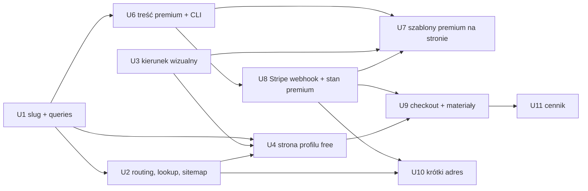

# feat: Strona firmy — darmowy profil + Premium w subskrypcji

## Przegląd

Plan składa się z trzech faz, z których każda daje wartość sama:

1. **Darmowy profil** `/firma/<slug>` dla każdego aktywnego wpisu. Daje SEO i link do outreachu.
2. **Treść premium** w modelu concierge: trzy szablony, cover, galeria, cennik usług i FAQ. Founder publikuje ją z JSON przez CLI.
3. **Subskrypcja Stripe**: checkout z profilu, webhook utrzymujący stan premium, automatyczny powrót do free, krótki adres `polvia.pl/<slug>`, wyższa pozycja na liście i przepisany `/cennik`.

## Ujęcie problemu

Firma w katalogu istnieje dziś tylko jako karta na liście i pin na mapie. Brakuje trzech rzeczy:

- **Produktu dla płatnego planu.** `/cennik` to statyczna makieta: przyciski CTA bez `href`.
- **Indeksowanego adresu dla każdego wpisu.**
- **Linku do outreachu.**

Model to darmowy profil dla każdego wpisu plus premium jako jego ulepszenie, sprzedawane w subskrypcji. Treść wpisuje founder, a rozliczenia działają automatycznie (zob. źródło: `docs/dev-brainstorms/2026-10-31-strona-firmy-premium-requirements.md`).

## Śledzenie wymagań

| ID | Wymaganie (skrót) | Unit |
|---|---|---|
| R1 | Stały, indeksowany adres `/firma/<slug>` (+ prefiks locale) | U1, U2, U4 |
| R2 | Darmowy profil: dane wpisu + wszystko co dziś karta (kontakt, godziny, WWW, social, WA/TG) | U4 |
| R3 | „Podobne firmy” z tej samej kategorii na free | U1, U4 |
| R4 | CTA „To moja firma — ulepsz stronę” na free | U4 (link), U9 (checkout) |
| R5 | Karta i popup linkują do profilu | U4 |
| R6 | Sitemap + metadane w 4 locale | U2, U4 |
| R7 | 3 szablony: Galeria / Profesjonalny / Klasyczny | U3, U7 |
| R8 | Cover + galeria | U3, U6, U7 |
| R9 | Cennik usług + FAQ (godziny/WWW/social są free — decyzja z planowania) | U3, U6, U7 |
| R10 | Brak „Podobnych firm” na premium | U7 |
| R11 | Krótki adres `polvia.pl/<slug>` → przekierowanie, tylko przy aktywnym premium | U10 |
| R12 | Wyższa pozycja na liście dla premium | U8 |
| R13 | Treść premium w 4 locale | U6 |
| R14 | Checkout powiązany z wpisem, miesięczny i roczny | U9 |
| R15 | Faktury i odnowienia automatycznie | U8 + Operator (Fakturownia/KSeF) |
| R16 | Formularz materiałów po płatności + powiadomienie foundera | U9 |
| R17 | Concierge: founder weryfikuje płacącego i publikuje | U6 (CLI) + Operator |
| R18 | Automatyczny powrót do free; treść premium zachowana | U6, U8 |
| R19 | `/cennik` obiecuje tylko to, co działa | U11 |
| Sukces | ≥5 płacących firm w 3 mies. | Operator: `service_subscriptions` daje liczbę wprost |

## Granice scope'u

Przeniesione ze źródła:
- Brak kont firm, logowania i panelu edycji.
- Brak automatycznego przejmowania wizytówek.
- Brak statystyk dla firm.
- Brak wyboru koloru marki i własnej domeny.
- Brak planu „Przedsiębiorstwo”, VIP i lead gen.
- Brak ukrywania kontaktu na darmowym profilu.

Dodane w planowaniu:
- **Brak zmiany slugu po utworzeniu.** Slug jest niezmienny; zmiana nazwy firmy nie zmienia adresu.
- **Brak refaktoru `service-card.tsx`.** Plik ma 768 linii i importuje `next/link`. Dodajemy tylko link do profilu przez `@/i18n/navigation`, bez przepisywania karty. Dług zgłoszony w sekcji Ryzyka.
- **Brak uploadu zdjęć przez formularz i zewnętrznego storage'u.** Zdjęcia premium trafiają do `public/` przez concierge, tak jak dziś loga.
- **Brak własnego portalu klienta.** Anulowanie i zmiana karty odbywają się przez no-code login link do Stripe Customer Portal.

## Kontekst i research

### Relevantny kod i wzorce

- **Schemat** (`src/db/schema.ts`):
  - `servicesTable` nie ma slugu ani kontaktu. Kontakt, `openingHours`, `socials` i `whatsappNumber` są na `serviceLocationsTable`, która ma unikalny `slug` lokalizacji (`<service>-<city>[-n]`).
  - `promotedServicesTable` (`priority`, `expiresAt`) jest już używana do rankingu. Sortuje `getServices()` w `src/lib/queries.ts`, a `src/lib/semantic-search.ts` filtruje `expires_at > NOW()`. Wygasanie rankingu działa więc za darmo na odczycie.
- **Slugi:**
  - `buildServiceSlug(name)` i `buildLocationSlugs()` są w `src/db/service-input-schema.ts`.
  - `seedService({ name, slug, … })` w `src/db/seed.ts` już przyjmuje `slug`, ale dziś służy on tylko jako baza slugów lokalizacji.
  - `src/db/add-service.ts` to runner `db:add`. Działa tylko na insertach i wykrywa kolizje slugów przez `findTakenSlugs`.
- **Routing:**
  - `src/i18n/routing.ts`: `localePrefix: 'as-needed'` z mapą `pathnames` (np. `/pricing` → `/cennik`).
  - `src/middleware.ts` waliduje slug mapy przed next-intl (wzorzec anty-soft-404), robi ręczny rewrite `/mapa/**` i 301 `/map/**`.
  - Matcher wyklucza `api`, `_next` i pliki.
  - `src/app/[locale]/loading.tsx` istnieje, więc **każda strona pod `[locale]` streamuje**. `notFound()` ani `redirect()` w `page.tsx` nie zmienią już statusu HTTP.
- **Zapytania:**
  - `src/lib/queries.ts` ma `server-only`, łączy tłumaczenia przez `servicesTranslationsAlias` z `src/db/aliases.ts` i filtruje przez `isPublicService` z `src/lib/public-service-filter.ts`.
  - Brak cache'u: strony renderują się dynamicznie.
- **Metadane:** `src/app/[locale]/blog/[slug]/page.tsx` i `src/app/[locale]/(main)/map/[[...slug]]/page.tsx` budują `alternates.languages` po `locales` z `@/i18n/config`.
- **Ścieżki locale:** `localePathPrefix()` i `localizedMapBasePath()` w `src/lib/map-url-builder.ts`.
- **Sitemap:** `src/app/sitemap.ts` + `src/app/sitemap.test.ts`.
- **Route handler + rate limit:** `src/app/api/submit-contact-query/route.ts` oraz `checkRateLimit` / `RateLimitStoreError` w `src/lib/rate-limit.ts`.
- **Mail do foundera:** `sendMail` + `getOperatorInbox()` w `src/lib/mailer.ts` (`SMTP_TIMEOUT_MS = 10_000`).
- **Karta i popup:** `src/app/[locale]/(main)/_components/service-card/service-card.tsx` (sekcja rozwinięta z przyciskami akcji) i `src/app/[locale]/(main)/_components/marker-popup.tsx`.
- **Loga:** `public/services/<plik>`; w bazie jest tylko nazwa pliku. `next.config.ts` nie ma `remotePatterns`.
- **Cennik:** `src/app/[locale]/(header)/pricing/page.tsx`, komponent `'use client'`. Teksty w `messages/*.json` → `Pricing.plans.*`.
- **Testy:**
  - Wzorzec bazowy: `src/components/ui/badge/badge.test.tsx`.
  - Komponenty z next-intl: `service-card.test.tsx`, `map-page-client.test.tsx`.
  - Route handler: `src/app/api/submit-contact-query/route.test.ts`.

### Wiedza instytucjonalna

- **Soft-404 przy streamowaniu** (`docs/solutions/deployment-issues/2026-08-22-soft-404-notfound-podczas-streamowania.md`):
  - Walidację slugu `/firma/*` i aliasu robimy w middleware.
  - Parsowanie ścieżek trzymamy w czystym module w `src/lib/`, bo middleware nie ładuje się w Jeście.
  - Przekierowanie aliasu to najpierw 307.
  - Status sprawdzamy przez `curl -w "%{http_code}"`.
  - Nowy `not-found` nie może kopiować `map/not-found.tsx` (to pozostałość po forku).
- **Prefiks locale z locale, nigdy `'/en'` na sztywno.** Test musi mieć asercję negatywną (`learned-patterns.md`).
- **`drizzle-kit push`, nigdy `generate`** (`docs/solutions/database-issues/2026-08-22-drizzle-generate-nieuzywalny-snapshoty.md`). `DATABASE_URL` wskazuje na **produkcję** (auto-memory).
- **Seed jest źródłem prawdy.** Treść premium musi przetrwać `db:reset`. Stan subskrypcji należy do Stripe, więc potrzebny jest skrypt resynchronizacji.
- **Timeout po nieodwracalnym kroku** (`docs/solutions/runtime-errors/2026-10-11-nieograniczony-czas-po-nieodwracalnym-kroku.md`): webhook najpierw robi idempotentny zapis, a skutki uboczne (mail) mają limit czasu.
- **Jest:**
  - Paczki ESM-only dopisujemy do `ESM_ONLY_PACKAGES`.
  - Ścieżki z `[locale]` i `(group)` w wzorcu jest escapujemy.
  - Mocki akcji React 19 rozwiązujemy przed końcem testu.
  - `URL.canParse` używamy tylko w testach z `@jest-environment node`.
- **Stałe dla klienta** w lekkich modułach bez zod i `src/db` (CLAUDE.md).

### Referencje zewnętrzne

- **BLIK w subskrypcjach Stripe:**
  - Changelog z kwietnia 2026 (Billing): https://docs.stripe.com/changelog/dahlia/2026-04-22/stripe-billing-blik-recurring-payments
  - Changelog z września 2026 (off-session): https://docs.stripe.com/changelog/endive/2026-09-30/blik-recurring-off-session-payments
  - Ograniczenia: tylko PLN, ≤2000 PLN, wymaga akceptacji Stripe.
- **Dokumentacja BLIK recurring:** https://docs.stripe.com/payments/blik/recurring-payments
- **KSeF.** Stripe nie wysyła faktur do KSeF. Standardem jest aplikacja Fakturownia ↔ Stripe: https://fakturownia.pl/apps/stripe-app
  - KSeF jest obowiązkowy od 1 kwietnia 2026.
  - Do końca 2026 faktury do 10 000 PLN miesięcznie mogą iść poza KSeF i nie ma kar.
- **Wzorzec webhooka:**
  - `request.text()` + `constructEvent`, runtime `nodejs`.
  - Deduplikacja po `event.id`.
  - Po każdym zdarzeniu stan pobieramy od nowa przez `subscriptions.retrieve`, bo zdarzenia przychodzą w dowolnej kolejności.

## Kluczowe decyzje techniczne

- **Stripe Billing + Checkout + hosted Customer Portal + Fakturownia.**
  - Odrzucone: Przelewy24 (cykliczne płatności, retry i portal trzeba pisać samemu) oraz merchant of record (5%+ prowizji, a i tak zostaje faktura KSeF do MoR).
  - Ceny w PLN definiujemy w Stripe Dashboard. Kod zna tylko identyfikatory cen z `env.ts` (allowlista: miesięczna, roczna).
  - **Nowa zależność `stripe`**: wymaga poinformowania usera przed instalacją (reguła 8).
- **Nowa kolumna `services.slug`** (unikalna). Odtwarzanie usługi ze slugu lokalizacji byłoby kruche. Backfill z `buildServiceSlug(name)` z sufiksem przy kolizji. `seedService` i `add-service` zapisują slug.
- **Walidacja istnienia `/firma/<slug>` i rozwiązywanie aliasu w middleware**, przez wewnętrzny route handler `GET /api/service-slug/[slug]` (Node, zapytanie do `db`, odpowiedź `{ exists, hasActivePremium }`).
  - Powód: middleware w Next 15.1 działa na edge, więc nie ma `db`. Z kolei `notFound()` i `redirect()` w `page.tsx` dają soft-404 przez `[locale]/loading.tsx`.
  - Middleware woła lookup tylko dla `/firma/<slug>` (z prefiksem locale lub bez) oraz dla **jednosegmentowych** ścieżek, które pasują do formatu slugu i nie są na liście zarezerwowanych.
  - Lookup ma jawny timeout. Gdy się nie powiedzie, żądanie przechodzi dalej, a profil renderuje się albo kończy jako 404 strony (świadomie akceptowany soft-404 w wyjątku).
- **Stan premium w osobnej tabeli `service_subscriptions`** (1:1 z usługą). Kolumny:
  - `stripeCustomerId`, `stripeSubscriptionId`
  - `status`, `currentPeriodEnd`, `cancelAtPeriodEnd`, `updatedAt`
- **Deduplikacja zdarzeń w `stripe_events`** (`id` pk).
- **„Premium aktywne” liczy jedna czysta funkcja** `isPremiumActive(subscription, now)` w `src/lib/premium.ts`. Zwraca `true`, gdy `status ∈ {active, trialing, past_due}` i `now < currentPeriodEnd + PREMIUM_GRACE_DAYS`.
  - Stan liczymy na odczycie, bez crona. Spełnia to R18 bez udziału foundera.
- **Ranking (R12) przez istniejącą `promoted_services`.** Webhook ustawia `expiresAt = currentPeriodEnd + grace`, więc zapytania rankingowe się nie zmieniają.
  - `promoted_services` pozostaje wtórnym zapisem: wynika z subskrypcji i jest nadpisywany przy każdym zdarzeniu.
- **Treść premium w osobnej tabeli `service_profiles`**:
  - `serviceId` pk, `template` (enum: `gallery` / `professional` / `classic`), `coverImage`
  - `gallery` jsonb, `priceList` jsonb, `faq` jsonb (z tłumaczeniami pl/uk/en/ru)
  - Jest niezależna od subskrypcji, więc po wygaśnięciu treść zostaje i wraca po wznowieniu (R18).
  - Jsonb zamiast tabel relacyjnych: nikt tych danych nie filtruje ani nie łączy, a Zod waliduje je na zapisie i odczycie (YAGNI).
- **Źródło treści premium to blok `premium` w `data/services/<slug>.json`.**
  - Nowy idempotentny CLI `npm run db:premium -- <plik>` robi upsert.
  - Seed wywołuje tę samą funkcję upsert dla każdego pliku z blokiem `premium`, więc `db:reset` niczego nie gubi.
  - Zdjęcia leżą w `public/services/<slug>/` i są commitowane przez concierge. Publikacja wymaga więc deployu, co jest akceptowalne przy ≤5 klientach.
- **Checkout to Server Action** w `src/app/[locale]/firma/[slug]/_actions.ts`, bo mutację wywołuje UI tego repo. Akcja:
  - waliduje Zodem `serviceId` i `interval`,
  - ma rate limit,
  - sprawdza, że wpis jest aktywny i nie ma już aktywnego premium,
  - tworzy sesję z `client_reference_id` i `subscription_data.metadata.serviceId`, z `tax_id_collection` (NIP),
  - kończy `redirect(session.url)`.
- **Formularz materiałów (R16) jest tekstowy.** Pola: wybór szablonu, cennik, FAQ i uwagi. Zdjęcia firma wysyła mailem na adres podany na stronie, bo bez storage'u nie da się zrobić uploadu.
  - Strona sukcesu weryfikuje `session_id` przez Stripe, więc formularz działa tylko dla opłaconej sesji.
  - Formularz wysyła maila do foundera przez Server Action z rate limitem.
- **Krótki adres (R11) przekierowuje tylko przy `hasActivePremium`.** Lista zarezerwowanych słów żyje w czystym module `src/lib/service-profile-path.ts`. Zawiera:
  - locale i wszystkie segmenty z `routing.pathnames` (pl i en),
  - `api`, `firma`, `dashboard`, `thanks`,
  - przekierowania z `next.config.ts`,
  - katalogi z `public/`.
- **Profil to Server Component** w nowym katalogu `src/app/[locale]/firma/[slug]/`. W `routing.pathnames` dostaje wpis `'/firma/[slug]'` (ten sam segment we wszystkich locale).
- **Szablony to osobne komponenty prezentacyjne** z jednym kontraktem propsów (`ServiceProfileView`). Wybiera je strona; same szablony nie znają stanu premium.
- **JSON-LD `LocalBusiness`** na profilu: tani zysk SEO, który wspiera R6.

## Otwarte pytania

### Rozwiązane podczas planowania

- **Godziny, WWW, social i WA/TG: free czy premium?** Free. Darmowy profil pokazuje to, co karta (decyzja usera; requirements doc zaktualizowany w R2, R9 i R19).
- **Operator płatności?** Stripe Billing, z BLIK recurring jeśli konto przejdzie akceptację, plus Fakturownia dla KSeF.
- **Gdzie trzymać zdjęcia?** W `public/services/<slug>/`, przez concierge. Bez nowego storage'u.
- **Czy wyższa pozycja reużywa `promoted_services`?** Tak, przez synchronizację z webhooka.
- **Generowanie slugu i kolizje?** `buildServiceSlug(name)`, a przy kolizji sufiks `-2`, `-3`. Slug jest niezmienny.
- **Jak wygasa premium bez crona?** `isPremiumActive` na odczycie, a w rankingu `promoted_services.expiresAt`.
- **Skąd brać listing przy CTA w `/cennik`?** Nie da się go ustalić, więc CTA prowadzi do „znajdź swoją firmę” (`/mapa`) z instrukcją, że ulepszenie kupuje się z profilu. Firma spoza katalogu idzie do `/dodaj-firme`.
- **Dobór „Podobnych firm”?** Ta sama kategoria, aktywne wpisy, bez własnego wpisu. Najpierw to samo miasto co główna lokalizacja, potem reszta. Maksymalnie 6 pozycji, bez kolejności rankingowej premium (prosta, przewidywalna kolejność).

### Odroczone do implementacji

- **Cena i waluta** (user/operator): Stripe Prices oraz kwoty w `Pricing.plans.essentials` w 4 plikach `messages/`. Research sugeruje PLN i rabat roczny w wysokości ~2 miesięcy. Kod nie zależy od kwot.
- **Okres karencji `PREMIUM_GRACE_DAYS`:** domyślnie 3 dni ponad okres Smart Retries. Finalna wartość po konfiguracji retry w Stripe.
- **Timeout lookupu w middleware i cache odpowiedzi** (`Cache-Control` / `s-maxage`): do zmierzenia na produkcji.
- **Limit galerii** (punkt odniesienia: 15) i wymiary cover. Do potwierdzenia przy U3.
- **Dokładny mechanizm zwrócenia statusu 404 z middleware dla `/firma/<nieistniejący>`:** rewrite na nieistniejącą ścieżkę albo odpowiedź 404 z treścią `not-found`. Wybrać to, co przejdzie test `curl` na statusie 404.
- **Brak `docs/DESIGN.md`:** buildery UI opierają się na `nextjs-stack-guidelines`, istniejących tokenach i kierunku wizualnym zaakceptowanym w U3. Utworzyć `DESIGN.md` przed kolejnym feature'em UI.
- **Analiza flow agentem `spec-flow-analyzer` nie została uruchomiona.** Edge-case'y przeanalizowano ręcznie (sekcja Wpływ systemowy). Do ewentualnego uzupełnienia w `/dev-docs-review`.

## Implementation Units

### Faza 1 — Darmowy profil

- [x] **Unit 1: Slug usługi i zapytania profilu**

**Cel:** Każda usługa ma unikalny, niezmienny slug, a warstwa danych potrafi zwrócić komplet danych profilu i „Podobne firmy”.

**Wymagania:** R1, R2, R3

**Zależności:** Brak

**Pliki:**
- Modyfikuj: `src/db/schema.ts` (kolumna `services.slug`, unikalna)
- Stwórz: `src/db/backfill-service-slugs.ts` (jednorazowy, idempotentny backfill; skrypt w `package.json`)
- Modyfikuj: `src/db/seed.ts` (`seedService` zapisuje `slug` usługi)
- Modyfikuj: `src/db/add-service.ts`, `src/db/service-input-schema.ts` (zapis slugu usługi i wykrywanie kolizji)
- Stwórz: `src/lib/service-profile-queries.ts` (`server-only`: `getServiceProfile(slug, locale)`, `getSimilarServices(serviceId, locale)`, `getServiceSlugStatus(slug)`)
- Test (unit): `src/lib/service-profile-queries.test.ts`, `src/db/add-service.test.ts` (rozszerzenie, jeśli istnieje, albo nowy)

**Delegate to:** feature-builder-web-data

**Skills in play:** nextjs-stack-guidelines, security

**Podejście:**
- Kolumna wchodzi najpierw jako nullowalna. Po backfillu dostaje `notNull` (dwa kroki `push`; zob. Operator checklist).
- Backfill: `buildServiceSlug(name)` z sufiksem przy kolizji, deterministycznie po `createdAt`.
- `getServiceProfile`:
  - zwraca usługę z tłumaczeniem dla locale (fallback na `services.name`), wszystkie lokalizacje z kontaktem, godzinami i social, oraz tagi w locale;
  - zwraca `null` dla wpisu nieaktywnego (`isPublicService`);
  - typ zwrotny wywodzi się ze schematu (`InferSelectModel`), a nie z ręcznego `Service` z `src/types`.
- `getSimilarServices`: reguła z „Rozwiązane podczas planowania”, maksymalnie 6.
- `getServiceSlugStatus(slug)`: lekkie zapytanie dla lookupu (U2). Na razie zwraca `{ exists }`; U8 dopisze `hasActivePremium`.
- Nowy moduł zamiast rozbudowy `queries.ts`, który ma już 345 linii (reguła 300 linii).

**Wzorce do naśladowania:**
- `src/lib/queries.ts`: `getServices` (join tłumaczeń przez alias, `isPublicService`)
- `src/db/service-input-schema.ts`: `buildServiceSlug` / `buildLocationSlugs`

**Scenariusze testowe:**
- [Unit] Dla istniejącego slugu i `locale='uk'` profil zwraca nazwę i opis z tłumaczenia `uk`. Gdy tłumaczenia brak, zwraca `services.name`.
- [Unit] Wpis o `status != 'active'` daje `null`.
- [Unit] Wpis online-only (lokalizacje bez współrzędnych) zwraca lokalizacje z `latitude = null` bez błędu.
- [Unit] `getSimilarServices` nie zwraca samego wpisu, zwraca tylko tę samą kategorię, maksymalnie 6, z tym samym miastem na początku.
- [Unit] Backfill: dwie usługi o tej samej nazwie dostają `nazwa` i `nazwa-2`. Ponowny run niczego nie zmienia.
- [Unit] `add-service` odrzuca JSON, którego slug usługi jest już zajęty, z czytelnym komunikatem.

**Weryfikacja:**
- `npx tsc --noEmit` bez błędów
- `npx jest src/lib/service-profile-queries src/db/add-service` przechodzi z oczekiwaną liczbą suite'ów
- grep: `src/lib/service-profile-queries.ts` zawiera `import 'server-only'`

**Operator checklist:**
- [ ] `npx drizzle-kit push` (kolumna nullowalna) **na produkcji**, bo `DATABASE_URL` wskazuje na prod. Potwierdzić kolumnę zapytaniem do `information_schema`.
- [ ] Uruchomić backfill, sprawdzić brak `NULL`, potem `push` z `notNull`.

---

- [x] **Unit 2: Routing `/firma/[slug]`, lookup w middleware i sitemap**

**Cel:** Adres profilu działa we wszystkich locale. Nieistniejący slug zwraca prawdziwy status 404 (bez soft-404), a profile są w sitemapie.

**Wymagania:** R1, R6

**Zależności:** Unit 1

**Pliki:**
- Modyfikuj: `src/i18n/routing.ts` (`'/firma/[slug]'` w `pathnames`)
- Stwórz: `src/lib/service-profile-path.ts` (czyste funkcje: `parseServiceProfilePathname`, `isReservedRootSegment`, `buildServiceProfilePath(locale, slug)` z użyciem `localePathPrefix()`, format slugu)
- Test (unit): `src/lib/service-profile-path.test.ts`
- Stwórz: `src/app/api/service-slug/[slug]/route.ts` (GET, Node, Zod na parametrze, `{ data: { exists }, error }`)
- Test (unit): `src/app/api/service-slug/[slug]/route.test.ts`
- Modyfikuj: `src/middleware.ts` (gałąź `/firma/<slug>` przed next-intl: lookup z timeoutem; brak wpisu daje status 404)
- Modyfikuj: `src/app/sitemap.ts`, `src/app/sitemap.test.ts` (wpisy profili × 4 locale)

**Delegate to:** feature-builder-web-data

**Skills in play:** nextjs-stack-guidelines, security

**Podejście:**
- Middleware zawiera tylko orkiestrację. Logika ścieżek siedzi w `service-profile-path.ts`, bo middleware nie ładuje się w Jeście.
- **Rate limit lookupu:** route jest publiczny, ale woła go głównie middleware. Limit per IP przez `checkRateLimit` z łagodnym progiem.
  - Uwaga: przy wywołaniu z middleware IP pochodzi z serwera, więc przekazać nagłówek klienta albo zwolnić ruch wewnętrzny. Wybór w implementacji, musi być bezpieczny.
- **Awaria lookupu** (timeout, 5xx): middleware przepuszcza żądanie dalej; brak twardego błędu dla użytkownika.
- **Sitemap** ma wszystkie 4 locale, bo opisy istnieją w 4 językach. Adresy budowane przez `buildServiceProfilePath`.

**Wzorce do naśladowania:**
- `src/middleware.ts`: walidacja slugu mapy (`parseMapPathname`) przed next-intl
- `src/lib/map-url-builder.ts`: `localePathPrefix()`
- `src/app/api/submit-contact-query/route.ts`: format odpowiedzi, Zod, rate limit

**Scenariusze testowe:**
- [Unit] `parseServiceProfilePathname`: `/firma/abc` daje `{ locale: 'pl', slug: 'abc' }`, `/uk/firma/abc` daje `uk`, a `/firma/` oraz `/firma/a/b` dają `null`.
- [Unit] `buildServiceProfilePath`: `pl` daje `/firma/x`, a `ru` daje `/ru/firma/x`. **Asercja negatywna:** żadne locale poza `en` nie dostaje `/en`.
- [Unit] `isReservedRootSegment` jest prawdą dla `mapa`, `cennik`, `pricing`, `blog`, `en`, `api`, `firma`, `services`, `privacy`.
- [Unit] Route handler: istniejący slug daje 200 `{ data: { exists: true } }`, nieistniejący `exists: false`, a niepoprawny format daje 400 z `error.code`.
- [Unit] Sitemap zawiera profil w 4 wariantach locale i nie zawiera wpisów nieaktywnych.
- [Manual] `curl -o /dev/null -w "%{http_code}" localhost:3000/firma/nie-istnieje` zwraca `404`, a `/firma/<istniejący>` zwraca `200`. Także dla `/uk/firma/...`. (Nie mierzyć po `npm run build` przy działającym dev serverze.)

**Weryfikacja:**
- `npx tsc --noEmit` bez błędów
- `npx jest src/lib/service-profile-path "src/app/api/service-slug" src/app/sitemap` przechodzi; liczba suite'ów zgodna z oczekiwaną
- `npx next lint` bez błędów

---

- [x] **Unit 3: Kierunek wizualny — komponenty prezentacyjne profilu i 3 szablonów**

**Cel:** Przed podłączeniem danych powstają komponenty prezentacyjne: darmowy profil i trzy szablony premium. Pokazane są w Storybooku na fixture'ach (desktop i mobile), do akceptacji przez usera. To realizuje decyzję „IU na kierunek wizualny” zamiast `DESIGN.md`.

**Wymagania:** R2, R3, R7, R8, R9 (warstwa wizualna)

**Zależności:** Brak (może iść równolegle z U1 i U2)

**Pliki:**
- Stwórz: `src/lib/premium-templates.ts` (lekkie stałe: `PREMIUM_TEMPLATES = ['gallery','professional','classic']`, limity galerii; bez zod i `src/db`)
- Stwórz: `src/app/[locale]/firma/[slug]/_components/service-profile-types.ts` (kontrakt `ServiceProfileView`: dane free + opcjonalne `premium`)
- Stwórz: `src/app/[locale]/firma/[slug]/_components/profile-free/profile-free.tsx` (+ `.test.tsx`, `.stories.tsx`)
- Stwórz: `src/app/[locale]/firma/[slug]/_components/template-gallery/template-gallery.tsx` (+ test, stories)
- Stwórz: `src/app/[locale]/firma/[slug]/_components/template-professional/template-professional.tsx` (+ test, stories)
- Stwórz: `src/app/[locale]/firma/[slug]/_components/template-classic/template-classic.tsx` (+ test, stories)
- Stwórz: współdzielone sekcje w `_components/` (np. `profile-contact`, `profile-hours`, `profile-price-list`, `profile-faq`, `profile-gallery`, `similar-services`), każda w folderze z testem
- Stwórz: `src/app/[locale]/firma/[slug]/_components/profile-fixtures.ts` (fixture'y: wpis lokalny z kompletem danych, wpis online-only bez mapy, wpis bez logo, premium z 12 zdjęciami, cennikiem i FAQ)
- Modyfikuj: `messages/pl.json`, `en.json`, `ru.json`, `uk.json` (namespace `ServiceProfile`)

**Delegate to:** feature-builder-web-ui

**Skills in play:** nextjs-stack-guidelines

**Podejście:**
- **Szablony różnią się układem i naciskiem**, nie danymi (zob. źródło, Kluczowe decyzje):
  - Galeria: duży cover i siatka zdjęć wysoko.
  - Profesjonalny: oszczędny nagłówek, a na pierwszym planie cennik i FAQ.
  - Klasyczny: zbalansowana wizytówka.
- **Każdy szablon musi poprawnie wyglądać bez cover, bez galerii i bez lokalizacji.** Premium może być opłacone przed publikacją treści.
- **Server Components tam, gdzie się da.** `'use client'` tylko dla interakcji, np. lightbox galerii.
- **Bez nowej biblioteki karuzeli/lightboxa**, chyba że user się zgodzi (reguła 8). Preferować natywny `<dialog>`.
- **Obrazy przez `next/image`**, z lokalnymi plikami z `public/`.
- Tokeny z `tailwind.config.ts`. Uwaga: skala `green` to w praktyce niebieski. Akcent marki `#C52289` jest dziś hardkodowany w `service-card.tsx`; tu wyciągnąć go do tokenu, jeśli używany.
- Linki tylko przez `@/i18n/navigation`.
- Mapa w profilu: statyczny podgląd albo link „pokaż na mapie” do `buildServiceUrl` zamiast osadzania Mapbox. Mapbox jest ciężki, a profil ma mieć dobre Core Web Vitals.

**Wzorce do naśladowania:**
- `src/app/[locale]/(main)/_components/service-card/service-card.tsx`: render godzin, kontaktu, social i przycisków WA/TG (odwzorować logikę, nie kopiować 768 linii)
- `src/components/ui/badge/badge.test.tsx`: wzorzec testu z `jest-axe`
- Auto-memory „Nową kartę listy odwzoruj z service-card”: mierzyć odstępy, nie oceniać okiem

**Scenariusze testowe:**
- [Unit] Każdy szablon i profil free renderuje nazwę jako nagłówek `h1` i przechodzi `jest-axe` bez naruszeń.
- [Unit] Profil free z fixture'm online-only nie renderuje sekcji mapy i adresu, a renderuje badge „online”.
- [Unit] Szablon bez `premium.gallery` nie renderuje pustej sekcji galerii.
- [Unit] `profile-free` renderuje sekcję „Podobne firmy” i CTA „To moja firma — ulepsz stronę” jako link.
- [Unit] Cennik renderuje pozycje w kolejności z danych, z ceną jako tekstem.
- [Unit] FAQ to rozwijane elementy (`
` lub odpowiednik) dostępne z klawiatury.

**Weryfikacja:**
- `npx tsc --noEmit` bez błędów
- `npx jest "src/app/\[locale\]/firma"` przechodzi
- `npx next lint` bez błędów
- grep: żaden plik w `src/app/[locale]/firma/**` nie importuje `next/link` ani `next/navigation`
- `npx jest src/i18n/messages-parity` przechodzi (klucze `ServiceProfile.*` obecne we wszystkich 4 plikach `messages/`)

**Operator checklist:**
- [ ] User przegląda w Storybooku profil free i 3 szablony (desktop 1440 i mobile 390) i akceptuje kierunek wizualny przed U4 i U7. Uwagi wracają jako poprawki do U3.

---

- [x] **Unit 4: Strona profilu (free), metadane i linki z karty/popupu**

**Cel:** `/firma/<slug>` renderuje darmowy profil z prawdziwymi danymi, z metadanymi SEO, hreflang i JSON-LD. Karta i popup mapy linkują do profilu.

**Wymagania:** R1, R2, R3, R4 (link), R5, R6

**Zależności:** Unit 1, Unit 2, Unit 3

**Pliki:**
- Stwórz: `src/app/[locale]/firma/[slug]/page.tsx` (Server Component: `getServiceProfile` + `getSimilarServices`, `generateMetadata`, JSON-LD)
- Stwórz: `src/app/[locale]/firma/not-found.tsx` (własny, nie kopia `map/not-found.tsx`)
- Stwórz: `src/lib/service-profile-metadata.ts` (czyste: budowa `alternates.languages`, canonical, opisu meta z obcięciem, obiektu JSON-LD `LocalBusiness`)
- Test (unit): `src/lib/service-profile-metadata.test.ts`
- Modyfikuj: `src/app/[locale]/(main)/_components/service-card/service-card.tsx` (link „Zobacz profil” w sekcji rozwiniętej przez `@/i18n/navigation`, z `stopPropagation`)
- Modyfikuj: `src/app/[locale]/(main)/_components/service-card/service-card.test.tsx`
- Modyfikuj: `src/app/[locale]/(main)/_components/marker-popup.tsx` (link do profilu)
- Modyfikuj: `src/types/index.ts` (tylko gdy `Service` potrzebuje pola `serviceSlug` dla linku) oraz `src/lib/queries.ts` (`getServices` zwraca `services.slug`)
- Modyfikuj: `messages/*.json` (4 pliki)

**Delegate to:** feature-builder-web-ui *(dotyka `queries.ts` tylko jedną kolumną w select. Jeśli zmiana warstwy danych urośnie, wydzielić do U1.)*

**Skills in play:** nextjs-stack-guidelines

**Podejście:**
- **Brak `<Suspense>` wokół głównej treści przed pobraniem danych.** `notFound()` jest tylko siatką bezpieczeństwa; właściwą walidację robi middleware (U2).
- **CTA w fazie 1** prowadzi do `/cennik` (`Link` z `@/i18n/navigation` na `/pricing`). U9 podmieni je na checkout.
- **`generateMetadata`:**
  - tytuł: `<nazwa> — <kategoria>, <miasto> | Polvia`,
  - opis z tłumaczenia,
  - `alternates.languages` dla 4 locale + `x-default`,
  - `openGraph.images` = logo albo cover.
- **JSON-LD:** `LocalBusiness` z adresem, telefonem i `openingHoursSpecification` dla wpisów z punktem obsługi; `Organization` dla online-only.

**Wzorce do naśladowania:**
- `src/app/[locale]/blog/[slug]/page.tsx`: `generateMetadata` z `alternates`
- `src/app/[locale]/(main)/map/[[...slug]]/page.tsx`: `openGraph`, `alternateLocale`

**Scenariusze testowe:**
- [Unit] `service-profile-metadata`: canonical dla `ru` to `/ru/firma/x`, `languages` ma 4 locale i `x-default`. Asercja negatywna na `/en` dla innych locale.
- [Unit] JSON-LD dla online-only nie zawiera `address` ani `geo`.
- [Unit] Opis meta jest obcięty do zdefiniowanej długości bez cięcia w środku słowa.
- [Unit] `service-card`: rozwinięta karta ma link „Zobacz profil” z `href` profilu w bieżącym locale. Kliknięcie linku nie zwija karty.
- [Manual] `/firma/<slug>` i `/uk/firma/<slug>`:
  - `h1` z nazwą firmy, sekcja „Podobne firmy”, CTA prowadzi do `/cennik` (pl) albo `/uk/pricing` (uk),
  - zero błędów konsoli,
  - `<link rel="alternate" hreflang>` dla 4 locale w źródle strony.
- [Manual] Z `/mapa` rozwinięcie karty i klik „Zobacz profil” otwiera profil tej firmy.

**Weryfikacja:**
- `npx tsc --noEmit` bez błędów
- `npx jest src/lib/service-profile-metadata "src/app/\[locale\]/\(main\)/_components/service-card"` przechodzi
- `npx next lint` bez błędów
- grep: `src/app/[locale]/firma/[slug]/page.tsx` nie zawiera `'use client'`

### Faza 2 — Treść premium (concierge)

- [ ] **Unit 6: Tabela treści premium, schemat JSON i CLI `db:premium`**

**Cel:** Founder publikuje i aktualizuje treść premium z bloku `premium` w `data/services/<slug>.json`. Treść przetrwa `db:reset` i zostaje po wygaśnięciu subskrypcji.

**Wymagania:** R7, R8, R9, R13, R17, R18 (zachowanie treści)

**Zależności:** Unit 1

**Pliki:**
- Modyfikuj: `src/db/schema.ts` (enum `profile_template`, tabela `service_profiles`)
- Stwórz: `src/db/premium-content-schema.ts` (Zod dla bloku `premium`: `template`, `coverImage`, `gallery[{ file, alt{pl,uk,en,ru} }]`, `priceList[{ name{…4}, price{…4}, note? }]`, `faq[{ q{…4}, a{…4} }]`; limity z `src/lib/premium-templates.ts`; reeksport stałych)
- Modyfikuj: `src/db/service-input-schema.ts` (opcjonalny klucz `premium` w schemacie wpisu, żeby strict nie odrzucał pliku)
- Stwórz: `src/db/upsert-premium-content.ts` (funkcja upsert po `slug` usługi, sprawdza istnienie plików zdjęć w `public/services/<slug>/`)
- Stwórz: `src/db/publish-premium.ts` (CLI: `npm run db:premium -- <plik> [--dry-run]`)
- Modyfikuj: `package.json` (skrypt `db:premium`)
- Modyfikuj: `src/db/seed.ts` (po wpisach: upsert treści premium dla każdego `data/services/*.json` z blokiem `premium`)
- Modyfikuj: `src/lib/service-profile-queries.ts` (`getServiceProfile` dołącza `premiumContent` zwalidowane Zodem przy odczycie, wersja dla locale)
- Test (unit): `src/db/premium-content-schema.test.ts`, `src/db/upsert-premium-content.test.ts`
- Modyfikuj: `.claude/skills/dodaj/SKILL.md` (sekcja „Wpis premium”: kroki concierge, w tym weryfikacja płacącego, zdjęcia w `public/services/<slug>/`, `--dry-run`, potem stop i OK od usera)

**Delegate to:** feature-builder-web-data

**Skills in play:** nextjs-stack-guidelines, security

**Podejście:**
- `--dry-run` wypisuje diff (co się zmieni) bez zapisu. To ten sam wzorzec co `db:add`.
- **Upsert jest idempotentny** (`onConflictDoUpdate` po `serviceId`), więc ponowne uruchomienie po poprawkach jest bezpieczne.
- Brakujący plik zdjęcia przerywa CLI z listą brakujących plików. Strona nigdy nie dostaje martwego obrazu.
- Odczyt w zapytaniu jest walidowany Zodem (`safeParse`). Błąd daje `premiumContent: null` i zalogowany błąd, a nie wywaloną stronę.

**Wzorce do naśladowania:**
- `src/db/add-service.ts` + `src/db/service-input-schema.ts`: walidacja JSON, `--dry-run`, resolwer obrazów
- `src/lib/categories.ts`: lekki moduł stałych reeksportowany przez schemat

**Scenariusze testowe:**
- [Unit] Poprawny blok `premium` przechodzi. Brak tłumaczenia `ru` w pozycji FAQ odrzuca blok ze ścieżką błędu.
- [Unit] Nieznany szablon jest odrzucany. Galeria ponad limitem jest odrzucana.
- [Unit] Upsert dla nieistniejącego slugu usługi kończy się błędem typowanym, nie cichym no-op.
- [Unit] Upsert dwa razy z tymi samymi danymi daje jeden wiersz i identyczną treść.
- [Unit] Brakujący plik w galerii przerywa z listą brakujących plików.
- [Unit] `getServiceProfile` z uszkodzonym jsonb zwraca profil z `premiumContent: null`.

**Weryfikacja:**
- `npx tsc --noEmit` bez błędów
- `npx jest src/db/premium-content-schema src/db/upsert-premium-content src/lib/service-profile-queries` przechodzi
- `npx next lint` bez błędów

**Operator checklist:**
- [ ] `npx drizzle-kit push` (enum + `service_profiles`) na produkcji. Potwierdzić tabelę i enum w `information_schema` i `pg_type`.

---

- [ ] **Unit 7: Strona profilu renderuje szablon premium**

**Cel:** Przy aktywnym premium profil renderuje wybrany szablon z treścią premium i bez „Podobnych firm”. Bez premium, także po wygaśnięciu, renderuje profil free, a treść zostaje w bazie.

**Wymagania:** R7, R8, R9, R10, R18

**Zależności:** Unit 3, Unit 6, Unit 8 (`isPremiumActive`)

**Pliki:**
- Modyfikuj: `src/app/[locale]/firma/[slug]/page.tsx` (wybór widoku: `isPremiumActive` → szablon z `premiumContent.template`, domyślnie `classic`; w przeciwnym razie `profile-free`)
- Stwórz: `src/app/[locale]/firma/[slug]/_components/select-profile-view.ts` (czysta funkcja: dane profilu + stan premium → `{ kind: 'free' } | { kind: 'premium', template }`)
- Test (unit): `src/app/[locale]/firma/[slug]/_components/select-profile-view.test.ts`
- Modyfikuj: `src/lib/service-profile-metadata.ts` (`openGraph.images` = cover przy premium)

**Delegate to:** feature-builder-web-ui

**Skills in play:** nextjs-stack-guidelines

**Podejście:**
- **Decyzja to unia dyskryminowana** w czystej funkcji. Strona tylko mapuje rodzaj widoku na komponent.
- Zapytanie o podobne firmy jest pomijane przy premium (nie pobieramy danych, których nie pokażemy).
- **Premium aktywne bez opublikowanej treści** daje szablon `classic` z danymi free, bez sekcji podobnych i bez CTA.

**Wzorce do naśladowania:**
- `src/lib/service-coverage.ts`: czysta funkcja podziału wyników testowana jednostkowo

**Scenariusze testowe:**
- [Unit] Premium aktywne z `template='gallery'` daje `{ kind: 'premium', template: 'gallery' }`.
- [Unit] Premium aktywne bez `premiumContent` daje `{ kind: 'premium', template: 'classic' }`.
- [Unit] Premium wygasłe z zachowaną treścią daje `{ kind: 'free' }`.
- [Manual] Wpis z aktywną subskrypcją testową renderuje wybrany szablon, nie ma sekcji „Podobne firmy” ani CTA. Po ręcznym ustawieniu `currentPeriodEnd` w przeszłości (baza testowa, nie prod) wraca do widoku free z „Podobnymi firmami”.

**Weryfikacja:**
- `npx tsc --noEmit` bez błędów
- `npx jest "src/app/\[locale\]/firma"` przechodzi
- `npx next lint` bez błędów

### Faza 3 — Subskrypcja

- [ ] **Unit 8: Stripe — stan premium, webhook, ranking, resync**

**Cel:** Zdarzenia Stripe utrzymują w bazie stan subskrypcji per wpis. Premium aktywuje się i wygasa automatycznie, wpis premium dostaje wyższą pozycję, a stan da się odtworzyć ze Stripe po `db:reset`.

**Wymagania:** R12, R15, R18

**Zależności:** Unit 1

**Pliki:**
- Modyfikuj: `package.json` (zależność `stripe` w przypiętej wersji; skrypt `db:sync-subscriptions`)
- Modyfikuj: `env.ts` (server: `STRIPE_SECRET_KEY`, `STRIPE_WEBHOOK_SECRET`, `STRIPE_PRICE_MONTHLY`, `STRIPE_PRICE_YEARLY`, `STRIPE_PORTAL_LOGIN_URL`; wszystkie także w `runtimeEnv`)
- Stwórz: `src/lib/stripe.ts` (`server-only`, klient z jawnym timeoutem i `apiVersion`)
- Modyfikuj: `src/db/schema.ts` (tabele `service_subscriptions` i `stripe_events`)
- Stwórz: `src/lib/premium.ts` (czyste: `isPremiumActive(sub, now)`, `PREMIUM_GRACE_DAYS`, `premiumRankingExpiry(sub)`)
- Test (unit): `src/lib/premium.test.ts`
- Stwórz: `src/lib/subscription-sync.ts` (`server-only`: `syncSubscriptionFromStripe(subscriptionId)`: pobiera subskrypcję, robi upsert w `service_subscriptions`, upsert lub usunięcie w `promoted_services` w jednej transakcji)
- Test (unit): `src/lib/subscription-sync.test.ts` (Stripe zamockowany jako serwis zewnętrzny)
- Stwórz: `src/app/api/stripe/webhook/route.ts` (`runtime = 'nodejs'`, `request.text()`, `constructEvent`, dedupe przez `stripe_events`, routing zdarzeń)
- Test (unit): `src/app/api/stripe/webhook/route.test.ts`
- Stwórz: `src/db/sync-subscriptions.ts` (CLI: listuje subskrypcje ze Stripe i woła `syncSubscriptionFromStripe` dla każdej)
- Modyfikuj: `src/lib/service-profile-queries.ts` (`getServiceProfile` i `getServiceSlugStatus` zwracają stan premium przez `isPremiumActive`)

**Delegate to:** feature-builder-web-data

**Skills in play:** nextjs-stack-guidelines, security

**Podejście:**
- **Obsługiwane zdarzenia:**
  - `checkout.session.completed`: powiązanie `customer` i `subscription` z `serviceId` z `client_reference_id`.
  - `customer.subscription.created`, `.updated`, `.deleted`
  - `invoice.paid`
  - `invoice.payment_failed`
  - Każde z nich kończy się `syncSubscriptionFromStripe`, czyli stan zawsze pochodzi ze świeżo pobranej subskrypcji. Odporność na kolejność.
- **Kolejność w handlerze:**
  1. weryfikacja podpisu (400 przy błędzie),
  2. `insert … on conflict do nothing` w `stripe_events` (duplikat daje od razu 200),
  3. synchronizacja,
  4. skutki uboczne (mail do foundera przy `checkout.session.completed`) przez `sendMail` z timeoutem, z błędem logowanym, a nie propagowanym.
- **Błąd synchronizacji daje 500**, więc Stripe ponowi. W takim wypadku wiersz `stripe_events` musi zostać wycofany: dedupe w tej samej transakcji co synchronizacja albo zapis po sukcesie.
- **Konflikt dwóch subskrypcji dla jednego wpisu:** druga aktywna subskrypcja nie nadpisuje pierwszej. Wysyła maila do foundera, żeby ręcznie zwrócił pieniądze.
- **Bez rate limitu na webhooku.** Jedyną bramką jest podpis Stripe (wyjątek od reguły „rate limit na każdym publicznym endpoincie”, uzasadniony; zanotować w kodzie).
- **Surowy błąd Stripe i bazy nie wraca w odpowiedzi.** Odpowiedź ma format `{ data, error: { code, message } }`.

**Notatka wykonawcza:** Zacznij test-first od `isPremiumActive` i od kontraktu webhooka: podpis, dedupe, kolejność. To granica płatności, więc najpierw testy ścieżek awarii.

**Wzorce do naśladowania:**
- `src/app/api/submit-contact-query/route.ts`: format odpowiedzi i obsługa błędów
- `src/lib/mailer.ts`: `sendMail` z `SMTP_TIMEOUT_MS`
- `docs/solutions/runtime-errors/2026-10-11-nieograniczony-czas-po-nieodwracalnym-kroku.md`

**Scenariusze testowe:**
- [Unit] `isPremiumActive`:
  - `active` z `currentPeriodEnd` w przyszłości → true,
  - `past_due` w karencji → true,
  - `past_due` po karencji → false,
  - `canceled` → false,
  - `active` z `cancelAtPeriodEnd` przed końcem okresu → true.
- [Unit] Webhook bez nagłówka lub ze złym podpisem → 400; synchronizacja nie jest wołana.
- [Unit] To samo `event.id` dwa razy → druga odpowiedź 200, synchronizacja wywołana raz.
- [Unit] Błąd synchronizacji → 500, a `event.id` nie jest oznaczone jako przetworzone (ponowienie przejdzie).
- [Unit] Zawieszony `sendMail` nie blokuje odpowiedzi ponad timeout; handler zwraca 200.
- [Unit] `syncSubscriptionFromStripe` dla `canceled` usuwa wpis z `promoted_services`, a dla `active` ustawia `expiresAt = currentPeriodEnd + grace`.
- [Unit] Druga aktywna subskrypcja dla wpisu z aktywną pierwszą nie nadpisuje stanu i wysyła powiadomienie.

**Weryfikacja:**
- `npx tsc --noEmit` bez błędów
- `npx jest src/lib/premium src/lib/subscription-sync "src/app/api/stripe"` przechodzi
- `npx next lint` bez błędów
- grep: brak `process.env` w nowych plikach; `STRIPE_SECRET_KEY` tylko w sekcji `server` w `env.ts`

**Operator checklist:**
- [ ] User akceptuje dodanie zależności `stripe`.
- [ ] Stripe Dashboard (tryb testowy, potem produkcyjny):
  - Produkt „Profesjonalny” z ceną miesięczną i roczną w PLN.
  - Włączony BLIK recurring (jeśli konto przejdzie akceptację) i karty.
  - Smart Retries z końcową akcją „anuluj subskrypcję”.
  - Włączony no-code login link do Customer Portal.
  - Endpoint webhooka z wybranymi zdarzeniami.
- [ ] Zmienne środowiskowe w Vercelu (osobne dla Preview i Production; Preview ma deployment protection, która blokuje webhooki).
- [ ] Aplikacja Fakturownia ↔ Stripe: faktura przy każdej płatności, z odnowieniami (zweryfikować, że faktura powstaje też przy odnowieniu), wysyłka do KSeF. Wyłączyć duplikujące PDF-y ze Stripe.
- [ ] `npx drizzle-kit push` (dwie tabele) na produkcji i weryfikacja w `information_schema`.
- [ ] Test lokalny: `stripe listen` + `stripe trigger` dla `invoice.payment_failed` i `customer.subscription.deleted`.
- [ ] Konsultacja z księgowym: traktowanie faktur za prowizje Stripe (odwrotne obciążenie).

---

- [ ] **Unit 9: Checkout z profilu i formularz materiałów**

**Cel:** Firma kupuje premium dla swojego wpisu jednym przyciskiem na profilu. Po płatności przesyła materiały, a founder dostaje maila.

**Wymagania:** R4, R14, R16, R17

**Zależności:** Unit 4, Unit 8

**Pliki:**
- Stwórz: `src/app/[locale]/firma/[slug]/_actions.ts` (`'use server'`: `startPremiumCheckout(formData)` i `submitPremiumMaterials(formData)`)
- Stwórz: `src/app/[locale]/firma/[slug]/_checkout-schema.ts` (Zod: `serviceId` uuid, `interval ∈ {monthly, yearly}`; schemat materiałów z limitami długości)
- Test (unit): `src/app/[locale]/firma/[slug]/_actions.test.ts`, `src/app/[locale]/firma/[slug]/_checkout-schema.test.ts`
- Stwórz: `src/app/[locale]/firma/[slug]/_components/upgrade-cta/upgrade-cta.tsx` (wybór miesięczny/roczny + submit; + test, stories)
- Stwórz: `src/app/[locale]/firma/[slug]/premium/dziekujemy/page.tsx` (sprawdza `session_id` w Stripe przed renderem; formularz materiałów; link do portalu i adres mailowy dla zdjęć)
- Stwórz: `src/app/[locale]/firma/[slug]/_components/premium-materials-form/premium-materials-form.tsx` (+ test)
- Modyfikuj: `src/i18n/routing.ts` (ścieżka strony sukcesu w `pathnames`, jeśli wymagana)
- Modyfikuj: `src/app/[locale]/firma/[slug]/_components/profile-free/profile-free.tsx` (CTA zamiast linku do `/cennik` → `upgrade-cta`)
- Modyfikuj: `messages/*.json` (4 pliki)

**Delegate to:** feature-builder-web-fullstack *(formularz bez akcji i akcja bez formularza są bezużyteczne)*

**Skills in play:** nextjs-stack-guidelines, security

**Podejście:**
- **`startPremiumCheckout`:**
  1. Zod,
  2. rate limit per IP (`checkRateLimit`),
  3. wpis aktywny i bez aktywnego premium (inaczej `{ error: { code: 'ALREADY_PREMIUM' } }`),
  4. cena z allowlisty env według `interval` (nigdy kwota z klienta),
  5. `checkout.sessions.create` z `mode: 'subscription'`, `client_reference_id`, `subscription_data.metadata.serviceId`, `tax_id_collection`, `billing_address_collection: 'required'`, `success_url` z `{CHECKOUT_SESSION_ID}` w bieżącym locale, `cancel_url` na profil,
  6. `redirect(session.url)`.
- **Strona `dziekujemy`** pobiera sesję. Gdy sesja nie jest opłacona albo `client_reference_id` nie pasuje do slugu, pokazuje komunikat z linkiem do profilu, a nie formularz.
  - Sukces nie zależy od webhooka. Strona mówi „premium aktywuje się w ciągu kilku minut”, bo webhook może przyjść później.
- **`submitPremiumMaterials`:**
  1. Zod,
  2. rate limit,
  3. ponowna weryfikacja `session_id` w Stripe (Server Action to publiczny POST),
  4. mail do foundera (`getOperatorInbox`) z treścią i danymi płacącego, z timeoutem,
  5. `aria-live` na wyniku.
- **Błędy dla użytkownika z tłumaczeń.** Surowy błąd Stripe nigdy nie trafia do klienta.

**Wzorce do naśladowania:**
- `src/app/[locale]/(dashboard)/dashboard/_actions.ts`: struktura Server Action z Zod
- `src/app/api/submit-contact-query/route.ts`: rate limit + mail
- `docs/solutions/testing-issues/2026-10-11-react-19-niezakonczona-akcja-blokuje-kolejne-testy.md`: mocki akcji w testach komponentów

**Scenariusze testowe:**
- [Unit] `startPremiumCheckout` z niepoprawnym `interval` → `BAD_INPUT`; Stripe nie jest wołany.
- [Unit] Dla wpisu z aktywnym premium → `ALREADY_PREMIUM`.
- [Unit] Po przekroczeniu limitu → `RATE_LIMITED`.
- [Unit] Poprawne dane → sesja tworzona z ceną z env dla danego interwału i z `client_reference_id = serviceId`.
- [Unit] `submitPremiumMaterials` z sesją nieopłaconą lub z innego wpisu → `FORBIDDEN`; mail nie jest wysyłany.
- [Unit] Błąd `sendMail` → typowany błąd dla użytkownika, bez surowego komunikatu.
- [Unit] `upgrade-cta` i `premium-materials-form`: `jest-axe` bez naruszeń; błędy walidacji połączone przez `aria-describedby`.
- [Manual] Tryb testowy Stripe:
  1. Na `/firma/<slug>` wybór „rocznie” i klik CTA przekierowuje do Checkout.
  2. Płatność kartą testową wraca na `/firma/<slug>/premium/dziekujemy`.
  3. Wysłanie formularza daje komunikat sukcesu, a founder dostaje maila.
  4. Po webhooku profil pokazuje premium.
  5. To samo na `/uk/...`.

**Weryfikacja:**
- `npx tsc --noEmit` bez błędów
- `npx jest "src/app/\[locale\]/firma"` przechodzi
- `npx next lint` bez błędów

---

- [ ] **Unit 10: Krótki adres `polvia.pl/<slug>` dla premium**

**Cel:** Firma z aktywnym premium ma krótki adres przekierowujący na profil. Bez premium ta sama ścieżka zwraca 404.

**Wymagania:** R11

**Zależności:** Unit 2, Unit 8

**Pliki:**
- Modyfikuj: `src/middleware.ts` (gałąź dla jednosegmentowej ścieżki: `isReservedRootSegment` → pomiń; poprawny format slugu → lookup; `hasActivePremium` → 307 na `buildServiceProfilePath('pl', slug)`)
- Modyfikuj: `src/app/api/service-slug/[slug]/route.ts` (pole `hasActivePremium`)
- Modyfikuj: `src/app/api/service-slug/[slug]/route.test.ts`
- Modyfikuj: `src/lib/service-profile-path.ts` (`parseRootAliasPathname`) + test

**Delegate to:** feature-builder-web-data

**Skills in play:** nextjs-stack-guidelines, security

**Podejście:**
- **Alias istnieje tylko bez prefiksu locale** i zawsze prowadzi na profil `pl`. Użytkownik i tak może przełączyć język na profilu.
- **307, a nie 308**, dopóki logika nie jest obserwowana na produkcji (przekierowania stałe są cache'owane na zawsze).
- **Lookup tylko dla ścieżek, które bez aliasu i tak dałyby 404**, więc istniejące strony nie zwalniają.
- **Kolejność gałęzi w middleware:** walidacja mapy, potem `/firma/*`, potem alias, potem rewrite i redirect mapy, potem next-intl. Udokumentować komentarzem.

**Wzorce do naśladowania:**
- Gałąź walidacji mapy w `src/middleware.ts`

**Scenariusze testowe:**
- [Unit] `parseRootAliasPathname`: `/firma-x` → `firma-x`; `/mapa`, `/en`, `/cennik`, `/api`, `/a/b`, `/` → `null`.
- [Unit] Route: wpis z aktywnym premium → `hasActivePremium: true`; wygasłym → `false`.
- [Manual] `curl -o /dev/null -w "%{http_code} %{redirect_url}" localhost:3000/<slug-premium>` → `307 …/firma/<slug-premium>`. `/<slug-free>` → `404`. `/mapa` i `/cennik` działają jak wcześniej (200).

**Weryfikacja:**
- `npx tsc --noEmit` bez błędów
- `npx jest src/lib/service-profile-path "src/app/api/service-slug"` przechodzi
- `npx next lint` bez błędów

---

- [ ] **Unit 11: Przepisanie `/cennik`**

**Cel:** Cennik obiecuje dokładnie to, co dostarcza premium, a jego CTA prowadzą tam, gdzie da się kupić albo zarządzać subskrypcją.

**Wymagania:** R19, R14 (wejście z cennika)

**Zależności:** Unit 9

**Pliki:**
- Modyfikuj: `src/app/[locale]/(header)/pricing/page.tsx` (CTA jako `Link` z `@/i18n/navigation`:
  - free → `/add-business`,
  - Profesjonalny → `/map` z parametrem albo kotwicą instrukcji „znajdź swoją firmę i kliknij Ulepsz”,
  - Przedsiębiorstwo → `/contact`;
  - link „Zarządzaj subskrypcją” do `STRIPE_PORTAL_LOGIN_URL` przekazany z Server Componentu)
- Stwórz (jeśli potrzebny podział server/client): `src/app/[locale]/(header)/pricing/_components/pricing-plans/pricing-plans.tsx` (+ test)
- Modyfikuj: `messages/*.json` (4 pliki), czyli `Pricing.plans.essentials.features`:
  - szablony, cover i galeria, cennik usług i FAQ, brak „podobnych firm”, krótki adres, wyższa pozycja;
  - usunąć: wyszukiwarkę semantyczną, powitanie w social mediach, promocje, link WWW i social media jako atut płatny.

**Delegate to:** feature-builder-web-ui

**Skills in play:** nextjs-stack-guidelines

**Podejście:**
- `page.tsx` staje się Server Componentem: czyta env portalu i tłumaczenia. Przełącznik miesięcznie/rocznie zostaje w małym komponencie klienckim (reguła: `'use client'` tylko dla stanu).
- **Kwoty zostają w `messages`.** Ich wartości uzupełnia user (odroczone).

**Wzorce do naśladowania:**
- Obecny `pricing/page.tsx` (struktura `PriceCard`)

**Scenariusze testowe:**
- [Unit] `pricing-plans`: lista cech planu Profesjonalny nie zawiera kluczy usuniętych obietnic. CTA free ma `href` do `/dodaj-firme` w `pl` i do `/en/add-business` w `en`. Przechodzi `jest-axe`.
- [Manual] `/cennik` i `/ru/pricing`: wszystkie CTA prowadzą do istniejących stron (brak `href="#"`), link do portalu otwiera stronę logowania Stripe, zero błędów konsoli.

**Weryfikacja:**
- `npx tsc --noEmit` bez błędów
- `npx jest "src/app/\[locale\]/\(header\)/pricing"` przechodzi
- `npx next lint` bez błędów
- grep: brak `href="#"` w `src/app/[locale]/(header)/pricing/**`

> Numeracja pomija U5: sitemap wcielono do U2.

## Wpływ systemowy

- **Graf interakcji:**
  - Middleware dostaje dwie nowe gałęzie, które wołają route handler.
  - `getServices` i `semantic-search` dostają ranking przez `promoted_services` bez zmiany zapytań.
  - Sitemap rośnie o 4 × liczba wpisów.
  - Karta i popup mapy dostają link.
- **Propagacja błędów:**
  - Awaria lookupu w middleware → żądanie przechodzi dalej.
  - Awaria synchronizacji w webhooku → 500, Stripe ponawia.
  - Awaria maila → log, bez wpływu na stan premium.
  - Awaria Stripe przy checkout → typowany komunikat dla użytkownika.
- **Ryzyka cyklu życia stanu:**
  - Zdarzenia w dowolnej kolejności rozwiązuje pobranie subskrypcji od nowa.
  - Duplikaty rozwiązuje `stripe_events`.
  - Subskrypcja przeżywa usunięcie lub dezaktywację wpisu w Stripe: founder musi ją anulować ręcznie (Operator / SKILL).
  - `db:reset` kasuje stan subskrypcji; odtwarza go `db:sync-subscriptions`.
  - Wyścig dwóch checkoutów dla jednego wpisu → druga subskrypcja nie nadpisuje stanu i trafia do foundera.
- **Parytet API:** stan premium czytają strona profilu, lookup i ranking. Wszystkie muszą przechodzić przez `isPremiumActive` lub `promoted_services` wyliczane z tej samej funkcji.
- **Pokrycie integracyjne:** pełna ścieżka checkout → webhook → widok premium → wygaśnięcie jest weryfikowalna tylko w trybie testowym Stripe ([Manual] w U7, U9, U10). Testy jednostkowe pokrywają każdy szew osobno.

## Ryzyka i zależności

| Ryzyko | Mitygacja |
|---|---|
| `DATABASE_URL` wskazuje na produkcję, a każdy `push` lub backfill trafia w żywą bazę | Kroki bazodanowe tylko w Operator checklist, po `--dry-run`. Weryfikacja w `information_schema`. Nigdy `db:reset`. |
| Soft-404 na `/firma/*` przez `[locale]/loading.tsx` | Walidacja w middleware (U2); test `curl` na statusie |
| Lookup w middleware dodaje latencję i wywołania funkcji | Tylko dla `/firma/*` i jednosegmentowych ścieżek spoza listy zarezerwowanych; timeout; cache odpowiedzi do ustalenia |
| BLIK recurring wymaga akceptacji Stripe i działa w ~9 bankach | Karty jako fallback zawsze włączone; brak zależności kodu od BLIK |
| KSeF i faktury przy odnowieniach przez Fakturownię niepotwierdzone | Operator weryfikuje w trybie testowym przed startem. Do końca 2026 próg 10 000 PLN miesięcznie pozwala wystawiać poza KSeF. |
| Publikacja zdjęć wymaga deployu | Akceptowalne przy concierge i ≤5 klientach. Storage dopiero przy samoobsłudze. |
| Nowa zależność `stripe` | Zgoda usera (Operator U8); wersja przypięta |
| `service-card.tsx` (768 linii, `next/link`) narusza reguły repo | Poza zakresem. Zgłoszone; osobne zadanie refaktoru. |
| Kierunek wizualny bez `DESIGN.md` i Figmy | U3 jako bramka akceptacji przed U4 i U7 |

## Dokumentacja / Notatki operacyjne

- `CLAUDE.md`: sekcja o profilu firmy i premium. Zawiera:
  - stan premium to wyłącznie `isPremiumActive`,
  - `promoted_services` jest wtórny,
  - walidacja `/firma/*` i aliasu żyje w middleware,
  - nowe trasy top-level trzeba dopisać do listy zarezerwowanych w `service-profile-path.ts`,
  - Stripe tylko przez `src/lib/stripe.ts`.
- `.claude/skills/dodaj/SKILL.md`: procedura concierge premium (U6).
- Po wdrożeniu `/dev-compound`: obszar Stripe i aliasu nie ma jeszcze wpisów w `docs/solutions/`.
- Rollout:
  1. faza 1 (profil free) może iść na produkcję sama;
  2. faza 2 jest niewidoczna bez subskrypcji;
  3. faza 3 najpierw na kluczach testowych, potem przełączenie env na produkcyjne;
  4. 307 aliasu zmienić na 308 po obserwacji.

## Fazowe dostarczanie

- **Faza 1 (U1–U4):** darmowy profil. Natychmiastowa wartość SEO i link do outreachu; można wdrożyć przed resztą.
- **Faza 2 (U6–U7):** treść premium. U7 wymaga `isPremiumActive` z U8, więc U8 można zacząć równolegle z U6.
- **Faza 3 (U8–U11):** płatności, alias i cennik. Start sprzedaży.

## Źródła i referencje

- **Dokument źródłowy:** [docs/dev-brainstorms/2026-10-31-strona-firmy-premium-requirements.md](../dev-brainstorms/2026-10-31-strona-firmy-premium-requirements.md)
- Strategia: `develop-strategy/monetyzacja.md`, `develop-strategy/Mechanizm Przejmowania Wizytówek.md`
- Kod: `src/middleware.ts`, `src/i18n/routing.ts`, `src/lib/queries.ts`, `src/db/schema.ts`, `src/db/add-service.ts`, `src/lib/map-url-builder.ts`, `src/app/sitemap.ts`
- Wiedza: `docs/solutions/deployment-issues/2026-08-22-soft-404-notfound-podczas-streamowania.md`, `docs/solutions/runtime-errors/2026-10-11-nieograniczony-czas-po-nieodwracalnym-kroku.md`, `docs/solutions/database-issues/2026-08-22-drizzle-generate-nieuzywalny-snapshoty.md`
- Zewnętrzne: https://docs.stripe.com/payments/blik/recurring-payments, https://fakturownia.pl/apps/stripe-app
